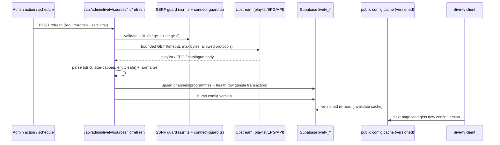
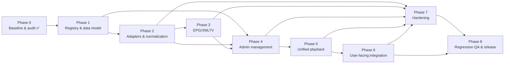

# MAVERO — Unified Live TV Source Management — Master Plan

**Status:** ACTIVE — Phase 0 (Baseline & Architecture Audit) ✅ executed; Phase 1 (Source Registry & Data Model) ✅ executed 2026-10-22 on branch `livetv/phase-1-unified-model` (merged via PR #17); Phase 2 (Source Adapters, Ingestion & Channel Normalization) ✅ executed 2026-10-22 on branch `livetv/phase-2-source-adapters` (merged via PR #18); Phase 3 (EPG/XMLTV Ingestion, Channel Mapping & Guide Data) ✅ executed 2026-10-22 on branch `livetv/phase-3-epg-xmltv` (merged via PR #19); Phase 4 (Admin Live TV Management) ✅ executed 2026-10-23 on branch `livetv/phase-4-admin-management` (merged via PR #20); Phase 5 (Unified Playback and Provider Integration) ✅ executed 2026-10-23 on branch `livetv/phase-5-playback-router` (merged via PR #21); Phase 6 (User-Facing Live TV Integration) ✅ executed 2026-10-23 on branch `livetv/phase-6-user-integration` (merged via PR #22); Phase 7 (Reliability, Security & Operational Hardening) ✅ executed 2026-10-23 on branch `livetv/phase-7-operational-hardening` (merged via PR #23); Phase 8 (Regression QA and Release) ✅ executed 2026-10-23 on branch `livetv/phase-8-release-qa` (delivered to `main` per owner instruction) — all automated gates exit 0, golden behaviors verified, release checklist `LIVETV_RELEASE_CHECKLIST.md` created; the RELEASE REMAINS PENDING the owner's production checks (browser matrix, deploy-log/first-tick verification, sign-off) per that checklist. **Post-release repair (R-0, owner-initiated 2026-10-23):** the admin create-form bug, the source-toggle/enablement clarity gaps, the preview-outcome dead surface and the unmapped-entry catalogue trap were fixed on branch `livetv/fix-m3u-admin-workflow` (merged via PR #24) — see §11. **R-1 (owner-initiated 2026-10-24):** the source-first admin & player workflow redesign was implemented on branch `livetv/r1-source-first-workflow` — see §18.
**Date:** 2026-10-22
**Baseline commit audited:** `120c4b5b429d1a361082db9af181c34c179f9fc5` (branch `main`, clean tree, synced with `origin/main`)
**Phase 0 execution log:** [`LIVETV_WORKLOG.md`](LIVETV_WORKLOG.md) (append-only, evidence-based)
**Historical Live TV documents (kept intact, cross-referenced — never replaced):**
- [`docs/live-tv-plan.md`](../live-tv-plan.md) — the completed LiveGT V1 integration plan (filename-frozen: cited by migration `20261103000000_live_tv_analytics_events.sql:10`; must never move or be renamed).
- [`docs/archive/round-reports/live-tv-worklog.md`](../archive/round-reports/live-tv-worklog.md) — the archived V1 implementation worklog (incl. the Shaka integration audit against shaka-player 5.2.12).

**Evidence labeling convention used in this document:**
- **[FACT]** — verified directly against the repository at the baseline commit (exact path given) or against a live read-only probe recorded in the worklog.
- **[ASSUMPTION]** — plausible but NOT yet verified; must be confirmed in the phase where it becomes load-bearing.
- **[DECISION REQUIRED]** — an open product/architecture question the owner must answer before the affected phase starts.

---

## 1. Product Objective and Scope

### 1.1 Objective

Build a **unified Live TV management system** in which an administrator can, from the existing Admin panel:

1. Configure **multiple authorized Live TV sources** (playlists, documented provider APIs, embed providers, manual direct streams, EPG/XMLTV guide sources) in one place.
2. Manage them **centrally**: add/edit/enable/disable, refresh, validate, inspect parsed channels, set priority, and choose the active source — with safe deletion and clear validation/error reporting.
3. **Control exposure**: decide which enabled sources and which channels are visible on the user-facing `/live-tv` page.
4. Observe **health**: source refresh status, parsing errors, per-source channel counts, and playback diagnostics without touching production streams.

The user-facing Live TV page continues to work exactly as it does today (LiveGT V1 as the built-in first source), and is progressively extended to render channels from the enabled source set with real metadata (logos, categories, current programme, programme artwork where genuine metadata exists, progress and upcoming schedule).

### 1.2 In scope (source types to support, where technically and legally appropriate)

| Source type | Description | Current-state anchor |
|---|---|---|
| `builtin_livegt_v1` | The existing LiveGT V1 API integration (catalogue, guide, fresh signed DASH/ClearKey resolution) | [FACT] `src/lib/client/live-tv/api.ts` — becomes a registered, non-deletable built-in source |
| `m3u_playlist` | M3U/M3U8 playlist URLs (e.g. iptv-org-style public playlists or authorized private ones) | [FACT] no parser exists yet; format verified reachable (worklog §R) |
| `api_provider` | Documented JSON provider APIs (channel catalogue + optional guide) | [FACT] LiveGT V1 itself is the reference contract; generic adapter is new |
| `embed_provider` | Embed (iframe) playback providers with documented postMessage protocols | [FACT] VOD side already has 14 embed adapters (`src/lib/client/player/adapter-registry.ts`); the LiveGT documented embed fallback (`/embed/{id}`) is the Live TV precedent |
| `manual_stream` | Manual, authorized direct stream URLs (HLS/DASH/MP4) entered by an admin | [FACT] analogous VOD patterns exist (`streaming_sources` templates, `direct_play_sources` out-of-band table — worklog §DB-3) |
| `epg_xmltv` | XMLTV guide sources (optionally gzip), mapped onto channels by ID | [FACT] none exists; LiveGT V1 JSON guide is the only guide today |

### 1.3 Capability honesty (non-negotiable design rule)

No provider supports all capabilities. Every source carries **capability flags** (§4.3) and the UI must never present an unsupported capability as available (e.g. no fake EPG for a playlist without guide data, no logo placeholder presented as channel artwork, no fake progress bar for non-seekable live streams — the existing rule in [`docs/live-tv-plan.md`](../live-tv-plan.md) §7 "Never show a fake VOD progress bar" is extended to all sources).

### 1.4 Explicit non-goals (whole project)

- **No** LiveGT V2 adoption ([FACT] V1 plan §2 forbids it; this project does not change that).
- **No** universal open stream proxy. Any server-side fetching is limited to **configuration data** (playlists, EPG, provider catalogue JSON) behind SSRF guards — never arbitrary media relay. Server-side media relay remains a [DECISION REQUIRED] (§13.1) with a default answer of "no".
- **No** DRM circumvention, geo-restriction bypass, header spoofing to defeat access controls, or use of undocumented provider interfaces. Future sources must be authorized streams and documented interfaces ([FACT] consistent with live-tv-plan §15 and repo security conventions).
- **No** replacement or rework of the VOD player, resolver, hosting, downloaders, CloudStream, device auth, or any unrelated subsystem.
- **No** wholesale adoption of JioTv_STB_Relay behavior (reference-only; §13.1).
- **No** automatic silent fallback between sources: fallback is explicit, configured, and bounded (§4.5).

---

## 2. Existing-System Constraints (confirmed facts Phase 0 must respect)

All items below were verified at the baseline commit; evidence paths are recorded in [`LIVETV_WORKLOG.md`](LIVETV_WORKLOG.md).

### 2.1 Stack and delivery

- SvelteKit 2 (`^2.37.0`) + Svelte 5 (`^5.38.7`) + Tailwind CSS 4 (`^4.1.12`) + `@supabase/supabase-js` (`^2.112.3`); Node >= 22 (`.nvmrc` = 22); package manager pinned `pnpm@10.30.3` (`package.json` `packageManager`); deploy on Netlify (`netlify.toml`, `DEPLOYMENT.md`).
- CI (`.github/workflows/ci.yml`) runs three gates on every push/PR: `pnpm check` (svelte-check, 0 errors), `pnpm build` (vite build + executor function), `pnpm test` (16 chained groups, 318 commands, offline against stubs/pglite — **CI never connects to production Supabase**). Any Live TV work must keep these green; the full chain stops at first failure.
- Shaka Player `5.2.12` and hls.js `1.7.2` are installed dependencies.

### 2.2 Live TV is deliberately isolated from VOD

- Live TV types are intentionally separate from VOD `PlayerSource` ([FACT] `src/lib/client/live-tv/types.ts` header, "ISOLATION CONTRACT", decision D5 of live-tv-plan §5/§13). **This isolation must be preserved**: the unified system must not force Live TV channels into VOD `PlayerSource` shapes nor let VOD code import Live TV types.
- Live TV playback is a small isolated engine ([FACT] `src/lib/client/live-tv/player.ts`): one Shaka instance per engine, caller-owned `<video>`, generation-token race protection, no auto-retry, structural Shaka types only, zero console calls.
- The VOD registry pattern to imitate (not import): ordered adapter registry with per-origin adapters + generic embed fallback ([FACT] `src/lib/client/player/adapter-registry.ts`).

### 2.3 LiveGT V1 contract (the built-in source)

- Base `https://livetgtv.lovable.app`; endpoints `GET /api/public/channels`, `GET /api/public/channels/{id}`, `GET /api/public/guide/{id}`; embed page `{base}/embed/{id}` ([FACT] `api.ts` §L79–83, L486).
- Live probe 2026-10-22: catalogue returned HTTP 200, `count=1176`, JSON shape matched the normalizer exactly (`id`,`name`,`category`,`logo`,`embed`,`watch`) (worklog §R-1).
- Playback is **always freshly resolved**, signed MPD + optional ClearKey, never cached/persisted/logged ([FACT] `api.ts` header + `resolveLiveTvPlayback`); the browser talks to the CDN directly (CORS-open, India-georestricted) — **no proxy exists or is planned for V1** ([FACT] `api.ts` §L9–10, live-tv-plan §2).
- Signed-query propagation `__hdnea__` (DASH segments + HLS variant playlists/segments, same-origin only, allowlist of exactly one parameter) is production-proven and MUST be preserved for the LiveGT source ([FACT] `src/lib/client/live-tv/media-auth.ts` header).
- Automatic embed fallback (LT-15) mounts the documented LiveGT embed iframe only after a fatal native failure and emits `live_tv_fallback_embed` ([FACT] `LiveTvPlayer.svelte` §L110–253, migration `20261104000000_live_tv_fallback_embed_event.sql`).

### 2.4 Client cache and analytics contracts

- Catalogue cache ≤ 5 min (16-entry LRU), guide cache ≤ 30 s (64-entry LRU), playback/DRM never cached ([FACT] `src/lib/client/live-tv/cache.ts` §L14–30).
- Analytics: closed CHECK-constrained taxonomy; the seven `live_tv_*` events + `live_tv_fallback_embed` exist; signed URLs/keys are regression-tested to never be sent ([FACT] migrations `20261103000000`, `20261104000000`; `src/lib/client/live-tv/analytics.ts`). New events require a new migration widening the CHECK (documented convention).

### 2.5 Admin panel conventions

- Admin2 shell owns navigation ([FACT] `src/lib/components/admin2/AdminAppShell.svelte` §L120–158): groups Command / Content / System / People; canonical source management lives at `/admin/system/api-sources` (tabs), and legacy routes `/admin/sources`, `/admin/providers`, `/admin/categories`, `/admin/defaults`, `/admin/addons`, `/admin/feature-control`, `/admin/operations` are 303 redirect stubs ([FACT] their `+page.server.ts`).
- Authorization is `profiles.role === 'admin'`, enforced server-side by `requireAdmin()` / `assertAdminClient()` ([FACT] `src/lib/server/streaming/admin-auth.ts`) and by RLS `using ((select public.is_admin()))` policies in migrations. Fail-closed everywhere.
- API conventions: consistent error envelope `{ ok:false, error:{ code, message } }` (`src/lib/server/http/error-response.ts`), 256 KiB body cap (`body.ts`), per-identity rate limiting (`rate-limit.ts`), redaction-aware structured logging (`log.ts`).
- Reusable admin UI components exist: `AdminCapabilityGrid`, `AdminStatusBadge`, `AdminSheet`, `AdminConfirmDialog`, `AdminCloudStreamManager`, `AdminHostingProviders` ([FACT] `src/lib/components/admin2/`).

### 2.6 Supabase / database constraints

- ~100 migrations under `supabase/migrations/`. The **Phase 7A streaming registry** ([FACT] `20260820010000_phase7a_streaming_registry.sql`) already implements a configuration-only provider/source registry for VOD: `streaming_providers` (`integration_type` ∈ template/api/direct/embed/custom, `capabilities` jsonb, `status` enum, `enabled`), `streaming_sources` (visibility, ordering, per-content-type URL templates, identifier_mode, quality/audio/subtitle capabilities), `streaming_categories`, `streaming_source_categories`, plus default-source slots, provider health, and `streaming_public_*` views consumed via `refresh_streaming_public_config` and served by the versioned cache in `src/lib/server/streaming/public-config.ts`. RLS: public-read policies with enabled/status filters + admin-all via `(select public.is_admin())`.
- **No Live TV tables exist** — V1 decision "no Live TV Supabase migration" ([FACT] live-tv-plan §13). The unified system intentionally revisits this with an additive, separately-reviewed migration (§9); that is an explicit architectural change to be approved with Phase 1.
- **Production schema drift exists**: two out-of-band production tables have no repository migration owner — `direct_play_sources` ("server-only experimental direct-play cache", 0 rows at the 2026-11 remediation audit, closed with restrictive deny-all RLS by `20261118000000_supabase_remediation_security_performance.sql` §1.b) and `user_streaming_credentials` (created outside tracked migrations, documented in `20260926000000_phase6b_streaming_credentials_initplan.sql` §L12–14). **Consequence: a fresh replay of the migration chain does not reproduce production state 1:1; any Live TV migration must be additive, idempotent, and drift-aware** (§9).
- Live read-only REST introspection (2026-10-22, worklog §DB-1) listed 41 relations matching `src/lib/server/supabase/database.types.ts` plus the two out-of-band tables above. No live table data was queried; no writes were performed.

### 2.7 Server infrastructure available for reuse

- **SSRF guard, battle-tested**: `src/lib/server/streaming/stremio/ssrf.ts` (two-stage: sync URL validation — http(s) only, no credentials, ≤ 2048 chars, host blocklist incl. cloud-metadata endpoints, IP-literal rejection incl. hex/octal/decimal and IPv4-mapped/NAT64 forms; then async DNS-answer validation) + `connect-guard.ts` (connect-time IP re-validation via undici Agent — closes the DNS-rebinding TOCTOU). This is the mandated foundation for any future server-side playlist/EPG fetch.
- Bounded caches (content `getOrSet` LRU), rate limiting, body caps, redaction logging, fail-closed hooks (`hooks.server.ts` + `src/lib/server/route-policy.ts`), health endpoint with deep/stats modes.
- `netlify.toml` CSP (§L19–110): `connect-src 'self' https://*.supabase.co …`, `frame-src *` (deliberately permissive for provider embeds), `media-src` for native-HLS browsers. **Constraint:** new direct-play stream origins may require CSP media-src/connect-src additions; each addition is a documented, reviewed change.

### 2.8 Test conventions

- Test scripts live in `scripts/*.test.ts` style files executed via `tsx` with `jsconfig.json` (or `tsconfig.behavioral.json` for browser-behavior suites); groups are wired in `package.json` (`test:livetv` currently chains 13 suites) and CI runs the full chain. Tests are offline/stub-based; one env-gated live smoke self-skips without `PRIVATE_SUPABASE_SERVICE_ROLE_KEY`. New Live TV work follows this pattern (no new frameworks).

---

## 3. Current-State Architecture Summary (as audited)

### 3.1 Live TV data/playback flow (today)

```text
/live-tv (+page.svelte, client-driven, 1376 lines)
   │  uses
   ▼
src/lib/client/live-tv/api.ts          LiveGT V1 client (normalizers, timeouts, abort)
   │  catalogue cache (cache.ts, 5 min / 30 s TTL+LRU)
   ▼
resolveLiveTvPlayback()  →  { channel, sources[], drm }   (fresh every call, no-store)
   │
   ▼
src/lib/client/live-tv/player.ts       LiveTvPlaybackEngine (Shaka 5.2.12)
   │  attach → configure (ClearKey) → load(mpd|m3u8)
   │  + media-auth.ts signed-query filters (__hdnea__, same-origin)
   ▼
caller-owned <video> (MSE)  ← LiveTvPlayer.svelte (1212 lines)
   │  on fatal native failure only
   ▼
LT-15 embed fallback: iframe {base}/embed/{id}  (+ live_tv_fallback_embed event)
```

Guide display helpers are pure functions in `epg.ts` (current programme from `nowPlaying` or timestamp scan, never fabricated; viewer-local rendering only). Recent channels, quality selection (LT-18 variant tracks), fullscreen/orientation, and analytics complete the module set (§2.2).

### 3.2 Component inventory and reuse assessment

| Existing asset | Path | Reuse verdict for unified system |
|---|---|---|
| LiveGT V1 client + normalizers | `src/lib/client/live-tv/api.ts` | **Keep as-is**; wrap as the `builtin_livegt_v1` source adapter behind the new registry |
| Playback engine + signed-query auth | `player.ts`, `media-auth.ts` | **Keep as-is**; multi-source concerns added *around* it (a resolution step that can consult non-LiveGT sources), never inside it |
| Embed fallback (LT-15) | `LiveTvPlayer.svelte` | **Keep**; generalize cautiously into an embed *mode* only with per-provider allowlisted origins + documented protocols |
| EPG helpers | `epg.ts` | **Keep**; add a source-agnostic guide provider interface above them |
| Client cache | `cache.ts` | **Extend** (per-source keys, bounded entries); never cache resolutions |
| VOD adapter-registry pattern | `src/lib/client/player/adapter-registry.ts` | **Imitate** (ordered, per-origin `canHandle`) for Live TV source adapters |
| Streaming registry schema + public-config versioned cache | `20260820010000…sql`, `public-config.ts` | **Extend/imitate** for Live TV tables (separate `livetv_*` tables; do not overload VOD rows) |
| SSRF guard + connect guard | `stremio/ssrf.ts`, `stremio/connect-guard.ts` | **Reuse** for admin-configured playlist/EPG/API fetching (server-side) |
| Admin auth, error envelope, rate limits, admin2 UI kit | §2.5 | **Reuse unchanged** |
| Analytics taxonomy mechanism | `20261103000000…sql` | **Extend** with new events via migration only |

### 3.3 Gaps (what does not exist yet)

1. No source registry for Live TV (no tables, no admin UI, no adapters beyond LiveGT).
2. No M3U/XMLTV parsing anywhere in the app ([FACT] repo-wide search — worklog §A-2).
3. No server-side fetch pipeline for configuration data outside the Stremio manifest service.
4. No channel-normalization layer spanning sources (each source would emit raw shapes today).
5. No source health/diagnostics surface for Live TV (VOD has `streaming_provider_health`).
6. **"TV Flix" does not exist under that name** in the repository ([FACT] case-insensitive searches for `tvflix|tv-flix|tv flix|tv_flix` return nothing). The closest match is the **TGVID** VOD embed provider (`https://tgvid.lovable.app`, documented `TGFLIX_EVENT`/`TGFLIX_CMD` postMessage protocol, registered in migration `20261113000000_vixolity_tgvid_zxcstream_providers.sql` and `src/lib/client/player/providers/tgvid-adapter.ts`). If "TV Flix" means TGVID, it is a **VOD** (TMDB-keyed, season/episode) embed — not a Live TV integration — and would only enter Live TV scope as a new, separately-evidenced embed provider. Recorded as [DECISION REQUIRED] (§13.2).

---

## 4. Target Architecture Proposal

> Everything in this section is a **proposal** to be ratified in Phase 1 after the schema review. Names are provisional. Nothing here has been implemented.

### 4.1 Layered architecture

```mermaid
flowchart TD
    subgraph Admin
        A1[Admin2 page<br/>/admin/system/livetv] --> A2[Admin API routes<br/>/api/admin/livetv/*]
    end
    subgraph Server["SvelteKit server (Netlify function)"]
        A2 --> S1[livetv admin-service<br/>validation + mutations]
        S1 --> DB[(Supabase<br/>livetv_* tables)]
        S2[livetv refresh worker<br/>fetch + parse + normalize] --> DB
        S2 --> G1[SSRF guard + connect guard<br/>reuse stremio/ssrf.ts]
        S3[livetv public-config<br/>versioned cache<br/>pattern: streaming public-config] --> DB
    end
    subgraph Client["Browser (user-facing /live-tv)"]
        U1[/live-tv +page.svelte/] --> U2[livetv catalogue service<br/>per-source adapters, ordered]
        U2 --> U3[[builtin_livegt_v1 adapter<br/>existing api.ts]]
        U2 --> U4[[m3u / api / manual<br/>catalogue adapters]]
        U1 --> U5[LiveTvPlaybackEngine<br/>player.ts — unchanged]
        U1 --> U6[EPG service<br/>epg.ts + guide providers]
    end
    S3 -.public config.<-> U2
    U5 --> CDN[Authorized upstream streams<br/>browser-direct, no proxy]
```

Design rules:

1. **The existing LiveGT client and player engine stay untouched.** The unified layer sits *above* them: a catalogue service merges normalized channels from enabled sources; a resolution step routes a channel to the adapter that can resolve it.
2. **Server owns configuration; client owns presentation.** Servers fetch/parse/normalize heavy configuration data (playlists, EPG, provider catalogues) into the registry; the client receives a bounded, versioned public config — mirroring the proven `streaming_public_*` + `public-config.ts` version pattern.
3. **No media proxy by default.** Playback remains browser-direct to authorized origins. Embeds remain iframes with allowlisted origins. Any relaxation requires the explicit relay decision (§13.1) with SSRF, rate-limit, size, and auth review.
4. **VOD isolation preserved.** New code lives in `src/lib/server/livetv/`, `src/lib/client/livetv/` (or extends `src/lib/client/live-tv/`), and `src/lib/components/live-tv/`; no import edges between VOD `PlayerSource` and Live TV types in either direction.

### 4.2 Source registry model (proposed)

A new, separate family of tables (Phase 1 deliverable; shape sketched, final DDL after schema review):

- `livetv_sources` — one row per configured source:
  - `id`, `name`, `slug`, `source_type` ∈ (`builtin_livegt_v1`, `m3u_playlist`, `api_provider`, `embed_provider`, `manual_stream`),
  - `config` jsonb (typed per source_type: URL, headers-none-by-default, provider endpoints, embed origins, format hints),
  - `capabilities` jsonb (§4.3), `enabled` boolean, `status` enum (active/disabled/maintenance/experimental/unavailable),
  - `priority` integer + `is_active` semantics (§4.5), `visibility` (public/internal/hidden) for user-facing exposure,
  - `builtin` boolean (the LiveGT V1 row is seeded, non-deletable, enabled-by-default to preserve today's behavior),
  - health columns: `last_refresh_at`, `last_refresh_status`, `last_error_kind`, `channel_count`, `refresh_in_progress`.
- `livetv_channels` — normalized channel rows per source: `source_id`, `source_channel_id` (the id used by that source), `stable_id` (deterministic hash of source + identity, §4.4), `name`, `category`, `logo_url`, `stream_kind` (dash/hls/direct/embed/unknown), `enabled_for_users` boolean + admin overrides, unique `(source_id, source_channel_id)`.
- `livetv_epg_sources` + `livetv_programmes` — EPG source config and parsed programme windows keyed by (`epg_source_id`, `channel_key`) with timezone-explicit windows.
- Secrets (if a provider ever needs credentials): server-only handling following the `user_streaming_credentials` precedent — **never** in `config` jsonb exposed to the client; storage design deferred to Phase 1 with an explicit RLS review. [ASSUMPTION: no Live TV source in scope requires stored credentials today.]

### 4.3 Capability flags (source-level, honest-by-construction)

`catalogue` (can list channels), `guide` (has EPG), `logos`, `categories`, `search`, `playback_kind` ∈ (`dash`, `hls`, `direct`, `embed`, `mixed`, `unknown`), `drm` ∈ (`none`, `clearkey`, `widevine`, `unsupported/unknown`), `geo_hint` (free text, informational only), `programme_images` (genuine programme artwork availability), `refresh_supported`.

Rules: flags are **set by the adapter based on verified provider behavior**, not wishes; the user UI renders strictly within the flags (e.g. `guide: false` ⇒ no Now/Next row at all, exactly like today's empty-guide honesty); `drm: unknown` renders the honest "may not play on this device" state rather than a spinner of doom.

### 4.4 Channel normalization model (proposed)

- Internal normalized shape extends today's `LiveTvChannel` (id/name/category/logo) with: `stableId`, `sourceId`, `sourceChannelId`, `streamKind`, optional `guide` hooks, optional `tvgId` (XMLTV mapping key for M3U `tvg-id` attributes).
- `stableId` = deterministic (e.g. SHA-256 of `sourceId + ':' + sourceChannelId`) — used for analytics content ids, recent-channels, and EPG joins; never the signed playback URL, never the raw upstream URL.
- Duplicate policy across sources: sources are ordered; the **first enabled source that provides a channel wins** by default; cross-source dedup keys are (normalized name + logo) with admin override ability — final dedup semantics is a Phase 1 acceptance item, not silently invented.
- Raw provider payloads never spread into the UI (extends the existing V1 rule, live-tv-plan §8).

### 4.5 Source selection, priority, and fallback semantics

1. **Explicit active source per channel** beats everything: if an admin pins a channel to a source, that source resolves it.
2. Otherwise, channels resolve from the **highest-priority enabled source that lists them** (admin-ordered `priority`).
3. **Fallback is opt-in, explicit, and bounded**: per-source "fallback on failure" toggle, at most one fallback hop, surfaced in the UI as "switched to <source>" with an analytics event; no silent infinite cascades. (Mirrors the bounded-recovery philosophy of live-tv-plan §11 and the resolver's bounded fallback in `src/lib/server/resolver/fallback.ts`.)
4. The built-in LiveGT V1 source keeps its **existing internal fallback** (LT-15 embed) — that behavior is source-internal and unchanged.

### 4.6 Refresh pipeline and data flow (proposed)



Stale-data behavior: if a refresh fails, the last good parsed snapshot stays served, health shows the failure, and the UI shows a "guide/data as of" note only where genuine data supports it (extends `formatGuideGeneratedAt` honesty, `epg.ts` §L180).

---

## 5. Admin Information Architecture (proposed, no implementation yet)

**Placement decision (evidence-based):** add a **Live TV** tab group as a new tab inside the canonical `/admin/system/api-sources` page **or** a sibling route `/admin/system/livetv` registered in the Admin2 `navGroups` "System" group ([FACT] registry at `AdminAppShell.svelte` §L129–145). Rationale: source management already lives there conceptually; the Admin2 registry is the single navigation source of truth; legacy routes are redirect stubs and must not be revived.

Proposed Admin surface (single coherent area, avoiding page sprawl):

1. **Overview & health** — per-source status cards (enabled, last refresh, error kind, channel count) reusing `AdminStatusBadge` / `AdminCapabilityGrid` patterns.
2. **Sources list** — add/edit/enable/disable/delete (delete requires confirm dialog + channel-impact preview), refresh now, validate config, inspect parsed channels (paginated, searchable).
3. **Channel catalogue** — cross-source channel list with source attribution, per-channel enable/disable for user exposure, dedup/override controls.
4. **EPG sources** — XMLTV source CRUD, mapping diagnostics (matched/unmatched channel ids), refresh status.
5. **Priority & activation** — drag-order priority, explicit active-source selection, fallback toggles.
6. **Diagnostics** — safe (redacted) last-error info, refresh history; **no** signed URLs, tokens, or key material anywhere in Admin UI or logs ([FACT] redaction conventions in `log.ts`; the Live TV rule against logging playback credentials extends to Admin).

Every mutation: `requireAdmin()` on the page, `assertAdminClient()` on the API route, RLS admin-write policies server-side, rate-limited, standard error envelope, optimistic-UI avoided for destructive ops. No changes to any existing Admin page's behavior (Phase 4 acceptance gates re-run `scripts/admin_nav_test.ts`, `admin2_phase*_test.ts` chains).

---

## 6. EPG Integration Strategy

1. **Sources**: XMLTV (`.xml`, `.xml.gz`) from admin-configured URLs; iptv-org/epg published guides are the reference public source (format and licensing verified — worklog §R-3/§R-4). LiveGT V1's JSON guide remains the built-in source's native guide (untouched).
2. **Parsing**: server-side, size-capped, entity-safe XML parsing ([ASSUMPTION] a hardening review must pick a parser configuration that disables external entity resolution / DTD fetch — Phase 3 acceptance item; SSRF guard wraps the download).
3. **Mapping**: M3U `tvg-id` / channel `stableId` → XMLTV `@xmltv_id`-style channel ids; unmatched-channel diagnostics stored (count + samples) and shown in Admin; mapping is admin-fixable (per-channel manual key override).
4. **Time**: XMLTV windows are timezone-explicit; stored as absolute UTC instants; display stays viewer-local via the existing pure helpers (extends the V1 timestamp contract — Unix seconds absolute instants, `epg.ts` §L9–19). No provider display strings feed logic (existing rule preserved).
5. **Current/upcoming**: `determineCurrentProgramme` semantics generalized (provider "now" hint first, then timestamp scan, never fabricated); "progress within programme" and "remaining" only render when a genuine current programme exists.
6. **Posters/programme images**: only from genuine programme metadata (XMLTV icon elements or documented API fields); never invented, never hot-linked from unrelated CDNs without review; missing image = existing logo/initials fallback.
7. **Retention**: bounded programme window (e.g. now − N hours → + N days), swept on refresh; stale-guide behavior: keep last good guide with visible "as of" note; missing guide for a channel renders the honest empty state (existing V1 rule).

---

## 7. Player / Protocol Compatibility Matrix

[FACT] rows 1–3 verified against the audited code; M3U rows are **format** facts — an M3U entry never guarantees playback (payload protocol/DRM/geo vary per stream). No playback claims are made beyond what the code or probes verify.

| Protocol / mode | Engine today | Where | DRM | CORS / CSP requirements | Known limitations |
|---|---|---|---|---|---|
| MPEG-DASH (`.mpd`) | Shaka 5.2.12 (Live TV engine) | `live-tv/player.ts` | ClearKey via `drm.clearKeys` config | Direct browser fetch; CDN CORS-open (LiveGT verified) | Signed `__hdnea__` must propagate to segments (`media-auth.ts`); Widevine NOT configured anywhere in Live TV |
| HLS (`.m3u8`) | Shaka sniffing in Live TV; hls.js 1.7.2 in VOD (`hls-engine.ts`) | live-tv `player.ts`; VOD `hls-engine.ts` | none | Same as above; CSP `media-src`/`connect-src` per origin (netlify.toml §L45–106) | HLS variant playlists also need signed-query propagation (LT-11, implemented) |
| Direct MP4 (progressive) | VOD DirectPlayerAdapter (`direct-adapter.ts`) | VOD only | none | `media-src` | Not a Live TV path today; manual_stream sources may need it — Phase 5 evaluates reuse of the VOD direct path *without* merging engines |
| iframe embed | EmbedPlayerAdapter + 13 provider-specific adapters (VOD); LT-15 LiveGT embed (Live TV) | `adapter-registry.ts`, `LiveTvPlayer.svelte` | provider-side | `frame-src *` already permissive (netlify.toml §L54) | Only documented postMessage protocols get rich controls (e.g. TGFLIX_EVENT/CMD); otherwise black-box |
| Widevine / PlayReady | **Not implemented anywhere** | — | — | — | Live TV has no Widevine config; honest `unsupported_drm`/`content_unsupported` error paths exist (`api.ts` `normalizeDrm`; Shaka codes 6000/6001/6010/6012/4032). No DRM bypass will be built |
| ClearKey (non-Shaka browsers) | n/a | — | — | — | Safari/iOS MSE+EME limits are real; the V1 plan already mandates explicit Safari QA (live-tv-plan §17); embed fallback remains the honest escape hatch for the built-in source |

Token/URL expiry handling: LiveGT-style signed URLs are resolved fresh per playback ([FACT] `api.ts`); future sources with signed URLs must declare their expiry semantics in `config` and follow the same never-persist/never-log rules.

---

## 8. Security and Privacy Requirements (plan-level; enforced per-phase)

1. **SSRF prevention for admin-supplied URLs** (Phase 2+ server fetching): mandatory two-stage validation + connect-time pinning via the existing `stremio/ssrf.ts` + `stremio/connect-guard.ts`; https-only unless a documented exception; no credentials in URLs; response-size caps; timeout caps; allowed-protocol allowlist.
2. **Redirect safety**: per-hop re-validation (pattern already proven in the Stremio fetch path and documented in `ssrf.ts` header).
3. **Bounded downloads**: playlists/XMLTV have max-bytes and max-entries limits at fetch AND parse time; oversized inputs fail with typed errors, never partial silent ingestion.
4. **XML safety**: parser must run with external entities/DTD resolution disabled (billion-laughs / exfil protection); parse failures are contained per-source (one bad source never breaks the page — per-source isolation).
5. **Rate limiting / upstream load**: admin refresh actions rate-limited per identity (`rate-limit.ts`); scheduled refreshes have per-source minimum intervals; jittered schedules; refresh concurrency bounded.
6. **No cache poisoning / cross-source leakage**: cache keys are source-scoped; public config is versioned and read-only to clients; user-generated channel state (recent channels) keyed by `stableId` only.
7. **Secrets & credentials**: no secrets in client-reachable config; redaction in logs (existing `log.ts`); signed playback URLs, ClearKey material, provider tokens never logged/persisted/emitted to analytics (extends regression-tested V1 rules); Admin diagnostics show error kinds, never raw upstream material.
8. **Authorization**: every admin action behind `requireAdmin`/`assertAdminClient` + RLS admin policies; public reads only through filtered public views/policies; no anon writes anywhere.
9. **Playback safety**: browser-direct only to allowlisted, admin-configured origins; embeds only for providers with documented interfaces and allowlisted origins; no arbitrary user-supplied playback URLs ever (extends live-tv-plan §15).
10. **Privacy**: analytics taxonomy remains closed; any new event must pass the "no URLs, no keys, no free-text" payload contract with a migration + regression test.
11. **Geo/licensing honesty**: source-level `geo_hint` is informational; the app never attempts circumvention; public playlist sources (iptv-org class) are attributed and their Unlicense terms noted; DMCA/NSFW blocklist awareness documented for iptv-org integrations.

---

## 9. Data Model, Migration and Rollback Strategy

1. **Additive-only migrations.** New `livetv_*` tables/policies in new migration files; zero edits to existing tables or frozen migrations; follow the repo conventions: `create table if not exists`, idempotent policies with `drop policy if exists` guards, comments explaining intent, and CHECK-constrained enums (patterns from `20260820010000_phase7a_streaming_registry.sql`).
2. **Drift-awareness.** Because production contains out-of-band tables (§2.6), each migration must be safe to replay on a fresh chain AND on drifted production (conditional DO-blocks where interaction with unknown objects is possible — pattern from `20261118000000` §1.b).
3. **Types**: regenerate `src/lib/server/supabase/database.types.ts` as part of the Phase 1 migration PR; CI `pnpm check` gates type drift.
4. **Rollback**:
   - Feature-level: the entire unified system is behind an enablement switch — disabled ⇒ `/live-tv` behaves exactly as today (LiveGT V1 only). This is the primary rollback lever and is rehearsed in Phase 1 acceptance.
   - Data-level: new tables can be dropped cleanly (no FK edges into existing tables); seeded built-in row is data, not schema, so dropping tables restores V1-only state.
   - Code-level: phases are structured so the user-facing page's LiveGT path is never the failure domain of new code (new sources render *additionally*, guarded by capability + enablement checks).
5. **Migration safety rule**: never apply destructive SQL; never reset the database; deployment ordering documented in the PR (mirroring the deploy-ordering safety style of `public-config.ts` `isMissingDefaultSlotsTableError`).

---

## 10. Regression-Prevention Strategy

- **Golden behaviors (must never change unless a phase explicitly says so):**
  1. `/live-tv` opens to the LiveGT catalogue with the existing category bar/search/grid UX.
  2. Playback resolution is always fresh; nothing about a resolution is cached or persisted.
  3. Signed `__hdnea__` propagation and ClearKey config behave byte-exactly as `media-auth.ts` implements today.
  4. LT-15 embed fallback activates only after fatal native failure, with its analytics event.
  5. Empty guide / no-logo / behind-live / error kinds render the honest existing states.
  6. VOD (`PlaybackManager`, all 14 embed adapters, HLS engine, resolver, hosting, downloaders) untouched.
- **Mechanics:** every phase runs `pnpm check`, the full `test:livetv` group, touched-area groups, and before release the full `pnpm test` + `pnpm build` (CI contract §2.1). New suites are added to `test:livetv` (or a new `test:livetv2` group wired into `test`) in the same PR that adds code. Parser work gets fixture suites including malformed-input cases. DB work gets migration tests following `supabase_remediation_migration_test.ts` / `adapter_build_lifecycle_migration_test.ts` patterns.
- **No silent behavior switches:** any change to default source ordering or channel visibility ships disabled-by-default with a documented admin enablement step.

---

## 11. Phased Roadmap

> Completion is never automatic: each phase exits only through its acceptance gates with recorded evidence. "Likely files" are **provisional** until the phase's own audit confirms them.

### Phase 0 — Baseline and Architecture Audit ✅ (this document + worklog)

- **Objective:** establish the evidence-based foundation without touching behavior.
- **Status:** executed 2026-10-22 at commit `120c4b5`; results in [`LIVETV_WORKLOG.md`](LIVETV_WORKLOG.md).
- **Completed:** git baseline; docs/instructions inspection; Live TV architecture audit; TV-Flix-uncertainty resolution; Admin registry audit; Supabase migration/RLS audit incl. live read-only introspection; reference-repo audits (JioTv_STB_Relay, iptv-org ×3); protocol/security audits; baseline checks (`pnpm check`, `test:livetv`, `test:supabase`, `pnpm build`).
- **Exit criteria met:** acceptance checklist §17; no source/migration/config changes; docs-only diff.

### Phase 1 — Source Registry and Data Model Design ✅ (executed 2026-10-22)

- **Objective:** ratify the target schema (§4.2) against the full existing schema; ship the additive migration + types + a server-side registry service — no UI yet.
- **Status:** EXECUTED on branch `livetv/phase-1-unified-model` from base commit `c1fb46f` (§11 Phase 0 head, verified in sync with `origin/main`). Evidence: [`LIVETV_WORKLOG.md`](LIVETV_WORKLOG.md) Phase 1 entries. Migration: `supabase/migrations/20261120000000_livetv_source_registry.sql`.
- **Deliverables (as shipped):** the additive `livetv_*` migration (8 tables, RLS, triggers, built-in seed, unified enablement switch); hand-maintained `database.types.ts` additions (repo has no Supabase CLI config — the file's documented "Added by …" convention); `src/lib/server/livetv/registry.ts` (typed vocabularies, per-source config validation with stage-1 SSRF gate, typed endpoint validation, effective-enablement rules, deterministic candidate ordering); `scripts/livetv_phase1_migration_test.ts` (PGlite, 60 checks) + `scripts/livetv_phase1_model_test.ts` (pure, 76 checks), both wired into `test:livetv`.
- **Ratified deviations from the provisional §4.2/§4.5 sketch (all evidence-based, documented in the worklog):**
  1. **Per-channel candidate list** (`livetv_playback_candidates`) implements the ratified priority semantics — an ordered (source, endpoint) candidate list per canonical channel with endpoint-level and candidate-level enablement — generalizing the sketch's single "active source" idea while keeping source-level `priority` as the default order when a channel has no explicit candidates.
  2. **Typed playback endpoints** (`livetv_playback_endpoints` with a DB-enforced `direct_stream ⇔ dash|hls` / `embed_page ⇔ null` pairing constraint) — an iframe URL can never be stored "as a manifest"; the playback engine is derived (`registry.ts` `playbackEngineForEndpoint`), never stored or prioritized.
  3. **RLS ships fail-closed admin-only** (no anon/public-read policies or views in Phase 1): no public consumer exists yet, so exposure predicates are decided together with the versioned public-config consumer (Phase 5/6) instead of speculatively. Admin authorization reuses `public.is_admin()` unchanged.
  4. **The registry module is pure** (no DB I/O): Phase 1 ships validation + enablement + ordering logic unit-tested without a database; the DB-serving layer arrives with its Phase 5 consumer (avoids speculative dead code).
  5. **EPG identity foundation only** (`livetv_epg_sources` + `livetv_epg_channel_mappings`, 1:1 per EPG source, plus `tvg_id` provenance on source entries) — ingestion untouched for Phase 3.
- **Dependencies:** Phase 0 (this document); owner sign-off on [DECISION REQUIRED] items §13.1–§13.4 (D-3 resolved conservatively for Phase 1: dedup stays explicit via nullable `dedup_key` + explicit canonical mapping; display-name equality never merges).
- **Original task list (kept for the record):** schema review vs §4.2; seed `builtin_livegt_v1`; RLS; capability/config jsonb shape validation (CHECK constraints); public-config versioned cache; enablement switch; migration + rollback rehearsal on a throwaway database (never production).
- **Non-goals:** no admin UI, no /live-tv changes, no fetching.
- **Acceptance (verified):** migration applies cleanly on a fresh local chain AND is idempotent on replay (PGlite Phase A); `pnpm check`/`pnpm build` green; registry model unit-tested; built-in source enabled-by-default preserves "LiveGT only" behavior with the unified system switch defaulting to FALSE; rollback levers documented (drop-tables / `unified_enabled=false`); no production database was touched.
- **Exit evidence:** migration + model suites green inside `test:livetv` (exit 0); exact commands/outputs recorded in the phase worklog.

### Phase 2 — Backend Source Adapters and Catalogue Normalization ✅ (executed 2026-10-22)

- **Objective:** server-side fetch+parse+normalize pipeline for `m3u_playlist`, `api_provider` and the built-in source; refresh reliability + state reporting; NO universal proxy.
- **Status:** EXECUTED on branch `livetv/phase-2-source-adapters` from base commit `92786e7` (verified as `origin/main` head — Phase 1 merged via PR #17). Evidence: [`LIVETV_WORKLOG.md`](LIVETV_WORKLOG.md) entries P2-0…P2-12.
- **Deliverables (as shipped):** the typed adapter contract (`adapters/types.ts`) with per-entry isolation + honest capability reporting; THREE adapters — `m3u_playlist` (strict-header bounded parser, extension-only format establishment, tvg-id/URL-hash identity), `api_provider` (generic mapping-driven catalogue engine + the ONE inspected documented profile `documented-catalogue-json-v1`, explicit endpoint-field mappings for future documented providers), `builtin_livegt_v1` (embed endpoint materialized via the client's own builder; direct streams deliberately NOT persisted — fresh-signed contract, `playbackResolution: 'fresh_signed'`); `fetch-safe.ts` (the ONE bounded/SSRF-guarded fetcher — stage-1+stage-2 per hop, connect-guarded, 12s/8 MiB/3-redirect caps, HTML never a source document); `ingestion.ts` (pure idempotent planner + bounded batch executor; admin-owned fields never written; nothing ever deleted — report-only stale strategy; zero candidate rows); `refresh-service.ts` (S1/S2 eligibility, per-instance duplicate-refresh guard, 45s deadline, per-source isolation, typed failure taxonomy, report-only state); three admin-only endpoints (`refresh`/`preview`/`status`) behind `requireAdmin` + new additive rate rules; three new suites in `test:livetv` (64 + 62 + 61 checks).
- **Ratified deviations/additions (documented in the worklog):**
  1. **Zero schema changes** — every Phase 2 requirement fits the Phase 1 columns; no second registry; no duplicated channel/endpoint tables; no candidate rows written by ingestion.
  2. **Refresh state is report-only** (no health columns exist in the Phase 1 tables); the persistent-refresh-history additive schema is PROPOSED separately (worklog P2-8) for owner review with Phase 4 — deliberately not implemented.
  3. **`embed_provider`/`manual_stream` intentionally have no Phase 2 adapter** (no upstream catalogue to fetch) — a typed `adapter_unavailable` gap, not a silent no-op.
  4. **The LiveGT hostname literal never enters server code** — the adapter imports `LIVEGT_V1_BASE_URL`/`buildLiveTvEmbedUrl` from the existing client (release-audit §4 isolation preserved; "reuse the existing client" honored verbatim).
  5. **Migration-history discrepancy** (version `20261120000000` absent from the recorded Supabase history while the tables ARE in production) — EXPECTED per `docs/supabase-migration-runbook.md` (manual SQL-Editor application does not write `schema_migrations`); read-only probes confirmed the production Phase 1 state; does NOT block Phase 2 (no schema changes); no reapply/fabrication/DDL.
- **Non-goals honored:** no EPG parsing (Phase 3); no playback changes/dispatcher (Phase 5); no Admin UI (Phase 4); no scheduler (Phase 7); `unified_enabled` stays FALSE; zero diffs under `src/lib/client/live-tv/**`, `src/lib/components/live-tv/**`, `src/routes/live-tv/**`, and all VOD paths.
- **Acceptance (verified):** fixture suites incl. malformed playlists (hostile attributes, oversized lines, entry caps, deadline, missing header) all produce typed errors or isolated per-entry diagnostics; SSRF guard rejects private/metadata/loopback/redirect-into-private targets (unit tests with injected resolvers/fetchers); one bad entry/source cannot affect another; repeated refresh applies ZERO writes (mock-DB uniqueness contract); admin-owned mapping/enablement/ordering survive refreshes byte-exactly; full 16-group regression chain green (`test:livetv` now 18 suites); `pnpm check` 0 errors; `pnpm build` green.
- **Exit evidence:** worklog P2-9 verification table (exact commands/exit codes); P2-10 file census; P2-12 stop confirmation.

### Phase 3 — EPG/XMLTV Integration ✅ (executed 2026-10-22)

- **Objective:** XMLTV (plain + gzip) ingestion, channel mapping, current/upcoming computation, diagnostics.
- **Status:** EXECUTED on branch `livetv/phase-3-epg-xmltv` from base commit `527faf3` (verified as `origin/main` head — Phase 2 merged via PR #18). Evidence: [`LIVETV_WORKLOG.md`](LIVETV_WORKLOG.md) entries P3-0…P3-12.
- **Deliverables (as shipped):** the dedicated XMLTV pipeline under `src/lib/server/livetv/epg/` — `time.ts` (the documented timestamp policy: explicit offsets mechanical; timezone-less values read in a CONFIGURED IANA timezone, never the server zone; fall-back ambiguity → the EARLIER instant; spring-forward gap → the pre-transition offset; component-wise calendar validation, leap seconds rejected), `xmltv.ts` (content-detected gzip via magic bytes + zlib `maxOutputLength` decompression budget; encoding policy — non-UTF-8 declarations refused; bounded channels/programmes/text/nesting/deadline; per-record isolation with typed skip reasons; document-level failures produce no partial snapshot), `mapping.ts` (pure planner: explicit `livetv_epg_channel_mappings` rows authoritative, tvgId auto-match ONLY on unanimous mapped entries, ambiguity/unmatched/invalid reported — display names never identity, case-sensitive after NFKC+trim), `ingestion.ts` (pure plan + bounded batch upserts keyed by the DB uniqueness `(epg_source_id, epg_channel_id, start_at, end_at)`; unchanged rows never written; upstream-omitted rows REPORTED, never deleted), `retention.ts` (one rule: strictly-past windows beyond a 24h grace deleted in bounded batches; current/upcoming structurally unreachable; idempotent), `queries.ts` (server-side current/upcoming helpers with explicit `now`, deterministic overlap/tiebreak ordering, ambiguity-guarded tvgId path, honest gaps), `guide-service.ts` (refresh orchestration mirroring Phase 2: eligibility gates, per-instance duplicate-refresh guard, 60s deadline, typed failure taxonomy incl. gzip/decompression/encoding kinds, report-only outcomes, dry-run preview); ONE additive fetcher mode (`fetchLivetvSourceBytes` — the SAME two-stage SSRF guard, connect-time validation, https-only, redirect/byte/deadline caps, extended to raw bytes with the HTML-is-never-a-document gate); THREE admin-only endpoints (`/api/admin/livetv/epg/{refresh,preview,status}`) behind `requireAdmin` + two NEW additive rate rules; ONE additive migration (`20261121000000_livetv_epg_guide_data.sql` — the `livetv_epg_programmes` table completing the Phase 1 EPG model: guide-keyed programme windows as timestamptz UTC instants, idempotency uniqueness, retention/window indexes, version-bump + updated_at triggers, admin-only fail-closed RLS); hand-maintained `database.types.ts` addition; three new suites in `test:livetv` (78 + 102 + 33 checks).
- **Ratified deviations/additions (documented in the worklog):**
  1. **The parser is cheerio 1.0.0** (`load(text, { xml: true })` — htmlparser2 XML mode), an ALREADY-INSTALLED, maintained dependency — no new package. Its security behavior is PROBED and PINNED by the suite: external DTD ids are inert (never fetched), DTD-declared entities are never expanded (billion-laughs structurally impossible), deep nesting does not recurse, and malformed XML is tolerated by the tokenizer — which is why the module performs its own explicit document-structure validation (root `<tv>`, required attributes, caps).
  2. **One additive migration was required** — Phase 1 shipped EPG identity only (sources + mappings); nothing persisted programme windows. The table keys rows by the GUIDE's own identity (provenance-preserving): an unmatched guide channel can never corrupt a mapping, a mapping change never loses guide data, and canonical association stays exclusively in the Phase 1 mapping table (consumed explicitly first, tvgId-derived second, at query time).
  3. **No atomic snapshot switch exists or is claimed** — supabase-js/PostgREST has no multi-statement transaction. The design does not need one: refreshes are convergent upserts that only add/update in place (readers never see an empty guide mid-refresh), nothing is deleted on refresh, and the retention sweep is the only (bounded, past-only) deletion. A failed/cancelled refresh therefore trivially preserves the last good guide.
  4. **Mapping rows are consumed, never written** — explicit `livetv_epg_channel_mappings` rows (admin-managed; the schema already represents them 1:1) are authoritative for lookups; Phase 3 creates no mapping rows (admin mapping tooling is Phase 4); the tvgId auto-path is a lookup-time derivation with an ambiguity guard (an identity claimed by two canonical channels serves nothing).
  5. **Report-only refresh state preserved** (per-instance, bounded) — persistent refresh history remains the separately-proposed schema idea (Phase 2 P2-8) for Phase 4 review.
- **Non-goals honored:** no UI changes; no LiveGT guide/client changes; no playback changes; no scheduler; no public guide API; `unified_enabled` stays FALSE; zero diffs under `src/lib/client/live-tv/**`, `src/lib/components/live-tv/**`, `src/routes/live-tv/**`, and all VOD paths.
- **Acceptance (verified):** fixture suites cover plain + gzip + truncated/invalid gzip + gzip bombs; external-DTD and entity-expansion payloads (inert, pinned); nesting/size/record-cap violations (document-level typed failures, no partial snapshots); explicit-offset, configured-timezone, DST fall-back/gap and multi-timezone fixtures (exact instants); invalid timestamps and `end <= start` (per-record skips); mapping diagnostics correct on a mixed match fixture (explicit/tvgId/ambiguous/unmatched/invalid); idempotent repeat ingestion (zero writes); failed-refresh snapshot preservation; single-record isolation; bounded retention never deleting current/upcoming (unit + PGlite levels); current/upcoming boundary conditions with an injected clock; abort/deadline handling; redaction (no URLs/XML/credentials in outcomes); LiveGT guide-helper regression checks. Migration suite (PGlite, 33 checks) proves apply/replay, CHECK contracts, DB-level upsert convergence, FK cascade scope, RLS fail-closed matrix, triggers and retention indexes.
- **Exit evidence:** worklog P3-9 verification table (exact commands/exit codes); P3-10 file census; P3-12 stop confirmation.

### Phase 4 — Admin Live TV Management ✅ (executed 2026-10-23)

- **Objective:** the admin surface of §5, integrated into Admin2 conventions with zero regressions to existing admin pages.
- **Status:** EXECUTED on branch `livetv/phase-4-admin-management` from base commit `34bb4cd` (verified as `origin/main` head — Phase 3 merged via PR #19). Evidence: [`LIVETV_WORKLOG.md`](LIVETV_WORKLOG.md) entries P4-0…P4-9.
- **Deliverables (as shipped):** the dedicated workspace `src/routes/admin/system/livetv` (+page.server.ts with the load + 30 form actions; +page.svelte with five `?tab=` sections: Overview & health / Playback Sources / Imported Channels / Canonical Channels / EPG Guides); the ONE new server module `src/lib/server/livetv/admin-service.ts` (source/channel/entry/endpoint/candidate/EPG-source/EPG-mapping CRUD, deterministic priority reordering, delete-impact accounting, per-EPG-source guide diagnostics via the Phase 3 `planEpgMapping`, the read-only overview feed for the Admin Overview card); nav registration in `AdminAppShell.svelte` (System group) + a Live TV metric card on the Admin Overview (the established mobile-reachability surface for System destinations); two new suites in `test:livetv` (71 + 50 checks).
- **Ratified deviations/additions (documented in the worklog):**
  1. **Dedicated route, not an api-sources tab** — the api-sources workspace is already a 1388-line VOD-registry surface; entangling Live TV there would mix two registries. `/admin/system/livetv` (the plan §5 first placement option) keeps the registries separate while reusing every Admin2 pattern.
  2. **Refresh-history decision (P2-8 review): RETAINED report-only** — no migration. The Admin UI shows the bounded per-instance records explicitly labeled "instance-local"; persistent history pays off only with the Phase 7 scheduler. NO schema change of any kind shipped in Phase 4 (zero migrations, zero type additions, production untouched).
  3. **Refresh-semantics-honest CRUD** — endpoint authoring/deletion and URL/kind edits are offered ONLY for adapter-less sources (manual_stream/embed_provider); adapter-fed endpoints accept exactly the admin-owned fields the Phase 2 ingestion never writes (enablement, ordering); imported entries support enable/disable + canonical mapping (no delete — a refresh would resurrect them). Deletes elsewhere (non-builtin sources, canonical channels, EPG sources, admin-authored endpoints, candidates, mappings) confirm with live impact counts; DB triggers/cascades stay the last line of defense.
  4. **Mutations are SvelteKit form actions** (the api-sources convention), calling the shared services server-side; the Phase 2/3 JSON endpoints remain the programmatic API surface and were not modified. Refresh/preview actions rate-limit with the existing `livetvAdmin*` rules.
- **Non-goals honored:** no changes to existing tabs' logic; no new roles beyond `profiles.role='admin'`; no Phase 5 dispatcher; `unified_enabled` read-only everywhere (zero writes to `livetv_config_meta`); zero diffs under `src/lib/client/live-tv/**`, `src/lib/components/live-tv/**`, `src/routes/live-tv/**`, VOD paths, migrations.
- **Regression risks (monitored):** nav registry edits (guarded by `admin_nav_test.ts` + `mav_focused_admin_nav_test.ts`, both green) and the release-audit Shaka isolation (the workspace documents engines as DERIVED without naming them — `live_tv_release_audit_test.ts` green).
- **Acceptance (verified):** full `test:admin` + `test:livetv` groups green (23 suites incl. the two new ones); authz enforced on load + every action (suite-pinned); deletes confirm with impact; no secret material rendered (redaction suite); all 16 `pnpm test` groups exit 0; `pnpm check` 0 errors; `pnpm build` green.
- **Verification:** `pnpm test:admin`, `pnpm test:livetv`, `pnpm test:supabase`, all 16 groups group-by-group, `pnpm check`, `pnpm build` — exact commands/exit codes in the worklog P4 verification table.

### Phase 5 — Unified Playback and Provider Integration ✅ (executed 2026-10-23)

> **Execution status:** implemented on `livetv/phase-5-playback-router` (base `df162e3` = the Phase 4 merge). The unified switch remains **FALSE** — the router ships behind the gate with the legacy path byte-identical; activation (flag flip + any admin configuration) is an explicit owner decision. Key realized decisions (full evidence in the worklog P5 entries): the builtin source's fresh-signed direct stream is NOT representable as an endpoint row (`url NOT NULL`) — the documented schema-gap answer is a SERVER-side synthesized candidate pair (direct → embed) injected into the registry's OWN default-mode ordering (no migration, no ordering code, nothing hardcoded first); EXPLICIT candidate mode stays registry-pure (rows only); selections with no mapped builtin entry resolve `resolved:false` and play through the untouched legacy flow (the compatibility rule that keeps LiveGT working at activation time); `resolved:true` with an empty candidate list is an honest retryable error. Two public GET endpoints (`/api/livetv/playback/config|resolve`) read the admin-only RLS tables via the service-role client (the `/api/downloader/mavero` public-read precedent) and return ONLY the bounded, redacted candidate wire. The client router reuses the pinned LT-15 failure classifier, runs bounded watchdogs (20s direct / 12s embed / 10s resolve fetch), attempts each candidate at most once per session, and treats a loaded embed as the terminal surface (LT-15 semantics). No migration, no `database.types.ts` change, no analytics-taxonomy change, zero diffs under the engine/media-auth/LiveGT-client/VOD surfaces.

- **Objective:** route a selected channel to the right playback path — existing Shaka engine for direct kinds; embed mode for embed providers; honest unsupported states.
- **Dependencies:** Phases 1–4.
- **Likely files (provisional):** `src/lib/client/live-tv/` new `resolution-router.ts` + `catalogue-service.ts`; `LiveTvPlayer.svelte` extensions (embed mode generalization of LT-15); `player.ts` UNTOUCHED.
- **Tasks:** resolution routing (source priority + explicit activation + bounded fallback §4.5); embed provider config (allowlisted origins, documented protocols only); DRM honesty (ClearKey only; unknown ⇒ explicit state); expiry semantics per source; keep VOD contracts untouched.
- **Non-goals:** no engine rewrite; no Widevine; no server proxy; no silent source switching.
- **Regression risks:** highest-risk phase for user-facing behavior — mitigated by keeping the LiveGT path as the untouched default and adding new paths only for non-builtin sources (disabled until an admin enables them).
- **Acceptance:** golden behaviors §10 all verified via existing suites (`live_tv_player_test`, `live_tv_embed_fallback_test`, `live_tv_hardening_test`) PLUS new multi-source suites; manual browser matrix (Chrome/Firefox/Safari/Edge desktop + Android Chrome) recorded for at least one non-LiveGT source and one embed source.
- **Verification:** full `test:livetv` + new suites; `pnpm check`; `pnpm build`.

### Phase 6 — User-Facing Live TV Integration ✅ (executed 2026-10-23)

> **Execution status:** implemented on `livetv/phase-6-user-integration` (base `fb74844` = the Phase 5 merge). The unified switch remains **FALSE** — the page's catalogue/guide/playback legacy paths run byte-identical while it is false (all pre-existing pins verified green). Key realized decisions (full evidence in the worklog P6 entries): the merged catalogue is served from the EXISTING Phase 1 tables by ONE new server read module (`user-catalogue.ts`) whose exposure rule is the registry's own (source enabled + playback-eligible status + `visibility='public'`, entry enabled + mapped (M0), channel enabled) — canonical PK uniqueness makes multi-entry duplicates structurally impossible, and the wire carries ONLY `{ id, name, category, logoUrl }` (never config/slugs/source ids/endpoint URLs); the Phase 5 resolver accepts the CANONICAL channel id as a playback selection ADDITIVELY (the builtin-entry path stays byte-identical; the synthesized builtin pair carries the ENTRY's source-channel id so the untouched client modules keep resolving/building; explicit mode stays registry-pure — the documented schema-gap limitation is NOT overridden); flag-ON guides come ONLY through the ESTABLISHED Phase 3 mapping contract (explicit mappings + ambiguity-guarded tvgId via `epg/queries.ts`) served by ONE bounded endpoint — no browser XMLTV fetch, no second pipeline, honest empty on missing/unmatched data; the flag read is ONE shared implementation + cache (`isUnifiedLivetvGateEnabled` in the router module — the page never fetches the flag); recents keep the SAME id-keyed store (stale ids drop out gracefully against the live catalogue). Two new public GET endpoints (`/api/livetv/{catalogue,guide}`) follow the Phase 5 public-read precedent (service-role reads of admin-only RLS tables, bounded DTOs, rate-limited, no-store). A flag-ON catalogue that is empty (production today: zero canonical channels) renders the existing honest empty state — never a silent legacy fallback. No migration, no `database.types.ts` change, no analytics change, netlify.toml untouched.

- **Objective:** render the merged, exposure-filtered catalogue with real metadata and EPG on `/live-tv`, preserving the existing UX language.
- **Dependencies:** Phase 5.
- **Likely files (provisional):** `src/routes/live-tv/+page.svelte`; `LiveTvChannelCard/CategoryBar/Guide*.svelte`; `src/lib/client/live-tv/{cache,types}.ts` extensions.
- **Tasks:** merged catalogue display (source-ordered, deduped); search + category filtering across sources; logos/categories from normalized rows; Now/Next/progress/remaining + upcoming guide where capabilities allow; empty/loading/error/stale states per capability flags; recent-channels keyed by `stableId`; mobile/fullscreen/keyboard/a11y parity with today.
- **Non-goals:** no redesign of the existing LiveGT presentation; no VOD surface changes.
- **Regression risks:** page is 1376 lines of shipped UX — changes are additive and capability-gated; existing suites (`live_tv_page_test`, `live_tv_page_redesign_test`, `live_tv_player_ui_test`) must stay green.
- **Acceptance:** with the unified system disabled, `/live-tv` is pixel-behaviorally the current page (suite + manual smoke); enabled with only the built-in source, identical catalogue; enabled with a second source, merged view follows §4.4/§4.5; a11y checks pass (`phase8_accessibility_test.ts` conventions).
- **Verification:** full `test:livetv`; `pnpm check`; `pnpm build`; recorded manual QA.

### Phase 7 — Reliability, Security, and Operational Hardening (EXECUTED — branch `livetv/phase-7-operational-hardening`)

- **Objective:** production-grade operations for the whole pipeline.
- **Dependencies:** Phases 2–6.
- **Tasks:** scheduled refresh with per-source intervals + jitter; health checks & safe diagnostics; retry/backoff policy (bounded); rate limits reviewed under real usage; SSRF/redirect re-audit; secrets/URL redaction audit (grep + suite); refresh-failure recovery runbook; monitoring hooks (`/api/health?stats=1` extension or admin diagnostics); operational runbook doc in `docs/livetv/`.
- **Non-goals:** no new features; no schema changes unless a hardening fix requires one (then additive + tested).
- **Acceptance:** hardening suite (timeouts, caps, redaction, authz) green; runbook reviewed; failure drills recorded (refresh failure, oversized playlist, dead EPG source, disabled source mid-session).
- **Verification:** `pnpm test` (full chain) + `pnpm check` + `pnpm build`.
- **Realized (Phase 7):** scheduler orchestration (`scheduler.ts`: deterministic pure planner + bounded 8s tick executor) exposed through a secret-gated `POST /api/livetv/scheduler/tick` (timing-safe, fail-closed 401/503 before any work, `livetvSchedulerTick` 4/min) AND an owner-gated Netlify scheduled function emitted at build time ONLY when `LIVETV_SCHEDULER_CRON` is set (no env ⇒ no schedule ⇒ nothing pretends otherwise). Per-source intervals live in the EXISTING config jsonb (`refreshIntervalMinutes` 15–10080, optional; default 720) — no scheduler table, no DDL on existing tables. Retry policy: ONE module (`retry.ts`), ONE layer (scheduler-only, ≤2 attempts, total budget, injected clocks), transient-only classification, bounded Retry-After (≤60 s, 429-only surfaced through the additive `fetch-safe.retryAfterMs`). Persistent history: P2-8 realized as the additive append-only `livetv_refresh_history` table (migration `20261122000000`, admin-only RLS, NO FKs — survives source deletion, sanitized+bounded text, no config-version coupling, best-effort writes that never fail a refresh, 30-day bounded retention sweep; NOT applied to any database). Health: public `/api/health` UNTOUCHED; the new admin-only `GET /api/admin/livetv/ops/status` distinguishes DB/refresh-subsystem/per-source health (bounded, sanitized categories, boolean flag, no playability claims). SSRF re-audit: existing fetch-safe protections behaviorally re-pinned (per-hop guards, private-address matrix incl. IPv6/mapped/NAT64, redirect cap, HTML gates, stream-cap cleanup, abort propagation) + fetcher-monopoly source pins. Redaction: `redact.ts` (URL + text sanitizers) with value-level secret regression tests; playback URL construction never imports it. Hardening fixes: in-flight guards keyed by the RESOLVED source id (id/slug dedup gap closed), bounded staleness reads (2k entries / 4k endpoints; 5k EPG rows) with honest truncation flags, ingestion executors honor the deadline signal between batches. Runbook: `docs/livetv/LIVETV_OPERATIONS.md` (activation, rollback, recovery, 10 recorded offline failure drills).

### Phase 8 — Regression QA and Release ✅ (executed 2026-10-23, branch `livetv/phase-8-release-qa`, base `50a811d` = the Phase 7 merge)

- **Objective:** release gate.
- **Tasks:** full `pnpm check` / `pnpm test` / `pnpm build`; complete golden-behavior pass (§10) incl. TGTV/LiveGT regression suites and embed suites; playlist/EPG fixture suite final run; authz + network-security suites; mobile/browser playback verification incl. Safari; deployment-readiness review (migration order, rollback rehearsal), release checklist in `docs/livetv/`, final worklog with commit SHA.
- **Exit:** owner sign-off; release notes; rollback criteria documented.
- **Realized (Phase 8):** QA-ONLY phase — zero application code/test/migration/config changes (the complete diff is documentation). Gates: `pnpm check` 0 errors; ALL 16 `pnpm test` groups exit 0 (34/34 test:livetv suites incl. 7 Phase 7 suites; per-group exit codes in worklog P8-1, with the honest execution-shape disclosure); `pnpm build` 0 with the honest scheduler no-op line; scheduler emission probes (valid cron ⇒ emitted + schedule frozen in-file; invalid cron ⇒ build fails exit 1); `git diff --check` clean; secret scan clean; Phase 7 protected-path claims independently re-verified (client LiveGT surface, routes, `/api/health`, netlify.toml, streaming, existing migrations all ZERO-DIFF vs `8beb349`; the only shared-file touches are the two documented additive ones). Golden behaviors §10 re-verified against the actual suites (evidence map in worklog P8-2): LT-2 62 / LT-3 91 / LT-4 22 / LT-5 13 / LT-6 / LT-15 15/15 / P1 76 / P2 187 / P3 213 / P4 121 / P5 202 / P6 128 / P7 321 checks — all green unchanged; DRM honesty (`drm_playback_failed`, no circumvention) and the ONE-fetcher monopoly re-confirmed. Browser QA: real headless-Chromium DOM-QA PASS (harness level, MAV components, 375/1280 viewports); every Live TV browser/playback scenario honestly NOT RUN (no Safari/WebKit, no real devices, no valid authorized source, no admin account) with the precise manual matrix in the release checklist. Deployment readiness: migration re-read + PGlite-proven + census-pinned (owner-reported applied; verification SQL in the checklist); scheduler build path probed BOTH ways; `unified_enabled` FALSE throughout (owner-reported; fail-closed suite-pinned); NO deploy triggered, NO flag/env/production change. Release checklist: `LIVETV_RELEASE_CHECKLIST.md` (gates ✅ with evidence; manual matrix / migration / deploy / first-tick / diagnostics / rollback / sign-off ⬜ pending owner). The release is NOT declared complete — §Exit items remain with the owner via that checklist.

---

## 11. Post-Release Repair R-0 — M3U admin workflow & unmapped-entry catalogue (owner-initiated 2026-10-23)

A focused, audit-based repair executed on branch `livetv/fix-m3u-admin-workflow` (Phase 8 remains the final PLANNED phase; this section records the owner-reported defect fixes). Full evidence: worklog entries R-0 (audit) and R-1 (implementation + gate outcomes).

- **Root cause 1 — create-form:** the source sheet's per-type Configuration fields keyed on `editingSource?.source_type`, which is always null while CREATING — the "Playlist URL (https)" input never appeared in create mode (same defect for the API/embed/manual types). The server validator was already correct (an empty `playlistUrl` is rejected), so the bug made playlist sources UNCREATABLE rather than unsafe. Fix: real `newSourceType` form state bound to the create select; the sheet keys its fields on the EFFECTIVE type (edit = immutable row type, create = live selection); the playlist input is client-`required` and documents that the URL may be a script/PHP endpoint with a query string (the fetched BODY must be a valid `#EXTM3U` playlist — validated end-to-end by new adapter-run tests).
- **Root cause 2 — catalogue M0 trap:** `getUnifiedLivetvCatalogue` dropped every UNMAPPED entry, so with the owner-reported registry state (502 imported LiveGT entries, ZERO canonical mappings) flipping `unified_enabled` ON would have produced an EMPTY user catalogue. Fix (ADDITIVE, flag-gated): unmapped + enabled entries of enabled + public + playback-eligible sources surface as bounded, deterministic `entry:<row-uuid>` rows after the canonical rows; mapped entries keep rendering ONCE through their canonical channel; no mapping is fabricated, no name-similarity merging (Phase 1 D-3 preserved), no source identity crosses the wire. The Phase 5 resolver gained the matching direct-entry identity (c): gates S1/S2/M1/E1 re-enforced server-side from the loaded rows, `visibility='public'` parity with the catalogue, https re-validation kept, the builtin's synthesized direct→embed pair reused for its entries, bounded 12 candidates, fail-closed (`resolved:false` for structural unknowns, honest managed-empty for gate-blocked selections). The new pure ordering lives in the registry (`buildDirectLivetvEntryOrder`).
- **Root cause 3 — workflow clarity:** the sources table showed only the operational `status` badge while the Power toggle flips `enabled` — an `active` badge on a disabled source visually implied enabled. Fix: a dedicated Enabled/Disabled badge beside Status, the toggle title explains its effect (excluded from refresh AND playback), per-row Refresh + Preview buttons now wired to the EXISTING rate-limited actions (previously unreachable), preview outcomes render (the `'source-preview'` kind was previously swallowed), a per-source "Last refresh" column (durable `livetv_refresh_history` latest row, graceful fallback to the instance-local outcome record), and the Imported Channels tab now defines imported entry / canonical channel / mapped / unmapped and states that mapping is the advanced optional path and unmapped ≠ invalid. `setLivetvSourceEnabled`/`updateLivetvSource` now verify the row actually changed (a 0-row match is a typed failure, never a silent success).
- **LiveGT V1 (§8 investigation, code-trace):** the flag-OFF production path is the untouched legacy client (fresh-signed resolution → Shaka/ClearKey → LT-15 embed fallback); the honest error taxonomy and the documented India-geo/ClearKey upstream reality stand. No Mavero-side defect that would universally break LiveGT playback was found; real-browser playback remains NOT RUN (no playback stack/authorized geo in this environment) — never bypassed.
- **Migrations: NONE needed** — the repair reads only existing columns/tables; the ingestion, mapping and RLS contracts are untouched. Production ledger parity remains an owner check (`LIVETV_RELEASE_CHECKLIST.md` §3 SQL).
- **Gates on the repair branch (all REAL exit codes):** `pnpm check` 0 (0 errors, the 5 pre-existing warnings); all 16 `pnpm test` groups exit 0 (test:livetv 34/34 suites — the five extended suites now 84 (P1) / 72 (M3U) / 81 (P4 service) / 78 (P4 UI) / 147 (P6) checks); `pnpm build` 0 (honest scheduler no-op line). `unified_enabled` stays FALSE; no deploy triggered; no production data/DDL touched.
- **Safe rollout (owner, after merge/deploy):** ① verify §3 migration SQL; ② create the playlist source (now possible) and Refresh it; ③ confirm its entries in the Imported Channels tab (unmapped is EXPECTED and fine); ④ make the source `public` + enabled; ⑤ flip `unified_enabled=true` (the owner-controlled master lever — the documented exact step this repair prepares for); ⑥ spot-check /live-tv and one `entry:`-row playback. **Rollback:** flip the flag back to FALSE (the entire unified surface, including every new behavior, disappears; /live-tv returns to byte-identical legacy LiveGT V1), or disable/delete the playlist source. The new code paths are strictly flag-gated and fail-closed.

---

## 12. Implementation Dependency Graph



Parallelization: Phase 3 can proceed alongside Phase 4 once Phase 2 lands; Phase 7 hardening items accumulate per-phase rather than being purely sequential.

---

## 13. Reference-Integration Notes and Open Decisions

### 13.1 JioTv_STB_Relay — reference audit (design input ONLY)

Audited via repository README/source listing 2026-10-22 (worklog §R-2). What it is: a JioTV playlist proxy + web player (TypeScript, TanStack Start, Bun) that fetches an upstream M3U playlist, caches it in-memory ~3h, rewrites channel lines (re-attaches `__hdnea__` tokens; injects `#EXTVLCOPT:http-user-agent` / `#EXTHTTP` cookie+UA headers; pipe-suffixed `|cookie=…&User-Agent=…`), and relays video requests through its own origin to bypass cross-origin restrictions; Shaka-based web player.

| Aspect | Reusable general pattern | Jio-specific (must NOT copy) |
|---|---|---|
| Playlist cache | Server-side fetch + bounded TTL in-memory cache + normalization before serving | Upstream credential acquisition, token refreshing |
| Header/token handling | The *concept* that some CDNs need per-request auth on child requests | UA/cookie spoofing pipelines (`EXTVLCOPT`/`EXTHTTP`/pipe-suffixes) — Mavero never spoofs to defeat access controls |
| Stream relay | — | The relay itself: conflicts with Mavero's no-media-proxy boundary (live-tv-plan §2) and turns the app into a stream proxy — [DECISION REQUIRED] §13.1, default NO |
| Player | Shaka player setup (Mavero already has a stricter, audited engine) | Jio host assumptions (`jiotvmblive.cdn.jio.com` token policy) — Mavero already implements the equivalent client-side (`media-auth.ts`) with production evidence |

**Net:** adopt the *playlist-cache-normalize* server pattern (already mirrored in §4.6); reject the relay and the credential/UA machinery. No license file was observed on the reference repo — treat as reference reading only, no code copying.

**[DECISION REQUIRED] §13.1 — server-side media relay:** default **NO** (preserves live-tv-plan §2 "no media proxying" and avoids Mavero becoming a public stream proxy). Revisit only with an explicit owner-approved threat model (SSRF, auth, bandwidth, geo/licensing).

### 13.2 iptv-org family — reference audit

- **iptv-org/iptv** (Unlicense): public M3U playlists organized by country/category/language; main playlist `https://iptv-org.github.io/iptv/index.m3u` — **probed 2026-10-22: HTTP 200, `content-type: audio/x-mpegurl`, `access-control-allow-origin: *`, daily `last-modified`** (worklog §R-2b). Limitations: links only, no control over destinations; streams may be geo-blocked, dead, or NSFW; a blocklist exists for DMCA/NSFW removals. **Integration shape:** admin-configured `m3u_playlist` source pointing at a chosen playlist URL; direct browser playback attempt (CORS-open), honest per-channel failure states; attribution note in Admin. Scheduled (not real-time) ingestion.
- **iptv-org/api** (Unlicense): static JSON datasets at `https://iptv-org.github.io/api/{channels,feeds,logos,streams,guides,countries,languages,categories,…}.json` — usable as enrichment metadata (logos, categories, feed→guide mapping). **Integration shape:** optional enrichment join keyed by channel identity; must be scheduled/cached server-side; never trust stream URLs blindly (same honesty rules).
- **iptv-org/epg** (Unlicense): XMLTV guides for thousands of channels, output `guide.xml` / `.xml.gz` (+ JSON option), channel ids of the form `xmltv_id` (e.g. `ArirangTV.kr`), daily builds published via GitHub Pages. **Integration shape:** reference `epg_xmltv` source; mapping via `tvg-id` ↔ `xmltv_id` with admin overrides (§6).

**What must be verified during implementation (not assumed):** per-playlist reachability + size; per-stream codec/DRM/geo reality (an M3U entry is a claim, not a guarantee); guide URL freshness; blocklist/NSFW filtering defaults; attribution presentation.

**[DECISION REQUIRED] §13.2 — "TV Flix":** no entity by that name exists in the repo ([FACT] §3.3). Closest is **TGVID** (`tgvid.lovable.app`, TGFLIX postMessage protocol) — a **VOD** embed provider. Owner to confirm: (a) TGVID was meant, in which case it stays out of Live TV scope unless a Live TV-capable provider is documented; or (b) an external "TV Flix" service was meant, in which case its documented interface must be supplied before any embed provider work (Phase 5) includes it.

### 13.3 Further open decisions

- **[DECISION REQUIRED] §13.3 — cross-source dedup key:** name+logo heuristic (proposed §4.4) vs admin-manual-only. Affects Phase 1 schema (unique indexes) and Phase 6 UX.
- **[DECISION REQUIRED] §13.4 — scheduled refresh ownership:** Netlify scheduled functions vs admin-triggered-only for Phase 2 (proposal: admin-triggered first; scheduling in Phase 7).

---

## 14. Unresolved Decisions and Assumptions Register

| ID | Type | Statement | Where it bites |
|---|---|---|---|
| D-1 | Decision | Server-side media relay allowed? (default NO) | Phase 2/5 |
| D-2 | Decision | "TV Flix" = TGVID (VOD) or an undocumented external? | Phase 5 embed scope |
| D-3 | Decision | Cross-source dedup semantics | Phase 1/6 |
| D-4 | Decision | Refresh scheduling mechanism | Phase 2/7 |
| A-1 | Assumption | No Live TV source in scope needs stored provider credentials | Phase 1 schema |
| A-2 | Assumption | XMLTV parser can be configured entity-safe (to be proven) | Phase 3 |
| A-3 | Assumption | Production `profiles.role='admin'` + `is_admin()` semantics are stable (verified in repo only, schema-level) | Phase 1 RLS |
| A-4 | Assumption | iptv-org playlist sizes stay within planned fetch caps (main index.m3u is large; per-country/category playlists smaller) | Phase 2 caps |
| A-5 | Assumption | LiveGT V1 remains available/CORS-open for the built-in source (verified 2026-10-22; re-verify per phase) | All phases |
| U-1 | Unverified | Actual production row counts / data shapes (never queried — only schema-level introspection performed) | n/a (out of scope by design) |
| U-2 | Unverified | Browser playback of any non-LiveGT source (no streams were played during Phase 0) | Phase 5 |

---

## 15. Verification Strategy and Test Gates

1. **Per-phase gates** (minimum): `pnpm check` + touched `test:*` groups + `pnpm build`, all with recorded exit codes in the phase worklog.
2. **Release gates** (Phases 7–8): full `pnpm test` (16 groups / 318 commands) + `pnpm build` + manual browser matrix incl. Safari + rollback rehearsal.
3. **Evidence rules:** no phase claims success without captured command output; un-runnable checks are recorded as not-run with reasons; no test is edited to make it pass; no unrelated failures are fixed silently inside a Live TV phase (documented and escalated instead).
4. **Live probes:** only read-only, no-credential, non-destructive probes (HEAD/GET of public endpoints, REST schema introspection) are permitted in audits; playback testing requires explicit phase authorization (Phase 5+).

---

## 16. Related Documents

- [`docs/live-tv-plan.md`](../live-tv-plan.md) — V1 integration plan (frozen filename; §13 "no Live TV Supabase migration" is superseded by this plan's Phase 1 **only after owner approval**).
- [`docs/archive/round-reports/live-tv-worklog.md`](../archive/round-reports/live-tv-worklog.md) — V1 implementation evidence (incl. Shaka audit).
- [`docs/architecture.md`](../architecture.md) — canonical current architecture (resolver, SSRF, health, deployment boundaries).
- [`docs/PLAN.md`](../PLAN.md) / [`docs/WORKLOG.md`](../WORKLOG.md) — product plan + general append-only work log.
- [`docs/supabase-migration-runbook.md`](../supabase-migration-runbook.md) — migration procedure (path-frozen).
- [`LIVETV_WORKLOG.md`](LIVETV_WORKLOG.md) — Phase 0 execution evidence (this project).

---

## 17. Phase 0 Acceptance Checklist

- [x] Current Git state inspected and pre-existing state preserved (clean tree at `120c4b5`).
- [x] Existing documentation and repository instructions inspected (README, DEPLOYMENT, docs/README, architecture, PLAN, WORKLOG, CI).
- [x] This plan contains the complete multi-phase roadmap.
- [x] `LIVETV_WORKLOG.md` records actual audit execution and results.
- [x] Live TV / LiveGT / player / EPG / embed paths documented with exact file paths.
- [x] Admin architecture and access-control conventions documented.
- [x] Supabase schema/migrations/RLS evidence documented, live-access limitation disclosed (schema-level introspection only; no row data).
- [x] JioTv_STB_Relay and iptv-org references audited with reuse/reject decisions.
- [x] Playback/protocol compatibility and security risks documented (§7, §8).
- [x] Baseline commands and results recorded accurately (worklog §V).
- [x] Future architecture includes safe failure handling and rollback (§4.6, §9).
- [x] No application source code, migrations, database, or production configuration changed (docs-only diff).
- [x] No existing feature changed.
- [x] Phase 1+ implementation NOT started.
- [x] Final Git diff contains only the approved Phase 0 documentation changes (+ minimal docs-index row, per repository convention — see worklog §F).

---

## 18. R-1 — Source-First Admin & Player Workflow (owner-initiated 2026-10-24, branch `livetv/r1-source-first-workflow`)

> Naming note: the owner's task codename **R-1** names THIS round. The worklog's earlier "R-0 / R-1" entries are the audit/implementation steps of the previous repair round (recorded here as §11 R-0); they are retained verbatim as history.

A complete, production-conscious redesign of the Live TV ADMIN SURFACE and the user-facing catalogue/player around a simple source-first workflow. NOT a data-model redesign: every table, migration, RLS policy, server action and backend capability of Phases 1–8 + R-0 remains (the canonical/EPG/mapping model stays intact in the backend; only the primary UI no longer requires it). The owner's `unified_enabled` lever is untouched and stays the fail-closed gate for every user-facing behavior added here.

### 18.1 Admin UI — source-first main page (`/admin/system/livetv`)

- The primary page renders ONLY: the "Live TV" heading, one "Add Source" button (top-right) and the source list. The five-tab workflow (overview/sources/entries/channels/epg), the overview dashboard, the entries/channels/EPG tables and every mapping control are REMOVED from the primary interface. `?tab=` URLs are still accepted (harmlessly ignored) so old links do not 400.
- Each source row shows exactly: name (+ slug/type), an ON/OFF toggle (right, bound to the PERSISTED `enabled` column — never the operational `status`), and Edit. The toggle shows a busy state while its request is in flight, blocks rapid repeat submits for the same source, and on failure falls back to the persisted value with an actionable error. Other sources are unaffected (per-row forms carry that row's id only).
- "Add Source" opens the compact create sheet: name, type select (bound form state — the R-0 fix preserved), the per-type Configuration fields (m3u playlistUrl / api baseUrl / embed allowedOrigins; server `validateLivetvSourceConfig` + SSRF guard remain the only authority), an explicit "Enabled immediately" checkbox (default OFF — no automatic enablement) and a "Show on Live TV page" visibility select (default `public` — the source-first availability model makes the toggle the primary control; the service validates everything).
- "Edit" opens the source sheet: (1) the configuration form (same fields + advanced registry state: status/visibility/priority/description, slug/type immutable as before), (2) a divider, (3) the source's channel section — bounded, paginated (50/page), searchable, with logo/name/status/stream-kind, loading/empty/error states, and per-source scoping (a response renders only when its `sourceId` matches the sheet's current source — no cross-source leakage on stale responses). Refresh (real) and Preview (dry run) stay available in the sheet header with the same typed outcome rendering. Delete stays in the sheet's danger zone behind the impact-confirm dialog.
- New bounded read action `?/sourceChannels` (admin-gated via `requireAdmin`, UUID-validated, page bounded through `listLivetvSourceChannelsForAdmin`) serves the channel section; no unbounded entry loads ever reach the browser.
- All advanced backend capabilities (entry enable/mapping, canonical channel CRUD, candidates, EPG sources/mappings/refresh, refresh-all) remain implemented server-side in `+page.server.ts`/`admin-service.ts` untouched — nothing is deleted; the primary UI simply no longer exposes them.

### 18.2 Catalogue — deterministic grouping & source alternatives (server)

- New pure module `src/lib/server/livetv/catalogue-groups.ts` — the deterministic grouping model (no DB I/O, unit-testable): input = eligible public sources (id/name/slug/priority) + their enabled entries + enabled canonical rows; output = ordered channel groups with bounded per-source alternatives. `user-catalogue.ts` performs the same bounded reads as R-0 and delegates grouping to it.
- **Identity precedence (conservative, documented):**
  1. Mapped entries (enabled) group under their canonical channel (`chan:<canonicalId>` — the trusted, admin-owned identity; several sources' entries collapse into ONE card, R-0's no-double-listing rule preserved).
  2. UNMAPPED entries group by EXACT normalized display-name equality (NFKC → trim → collapse internal whitespace → casefold). This is an EXACT-match fallback, never fuzzy matching: no similarity scores, no token/prefix heuristics, no transliteration. Unrelated channels with similar-but-not-identical names are never merged. Name-groups never merge into canonical groups (an unmapped entry with a name equal to a canonical channel stays its own name-group — canonical grouping requires the explicit mapping).
  3. Every group key is scoped to its identity space; the same DB entry row can never be emitted twice (each row iterates once; groups are keyed).
- **Group display metadata:** canonical groups carry the canonical row's name/category/logo; name-groups carry the preferred member's. Preferred member order (deterministic): source `priority` ASC → source `slug` ASC → entry `source_channel_id` ASC → entry row `id` ASC — the existing priority-and-eligibility rules, unchanged.
- **Card identity:** canonical groups keep the canonical id (stable across refreshes, recents-compatible); name-groups keep the R-0 direct identity of the preferred entry (`entry:<rowId>`). If a preferred source is disabled, the group re-derives from the remaining eligible members (canonical cards keep their id; name-groups re-anchor deterministically).
- **Alternatives (additive wire field):** each catalogue row may carry `sources: [{ id: '<selectionId>', label: '<source display name>' }]` — bounded to 6, ordered by the same preference comparator, one entry per contributing source (that source's best-ranked eligible member; its `entry:<rowId>` selection id). This is a deliberate, bounded DTO extension: labels are admin display names (never config, URLs, slugs or visibility data); the ids are the established `entry:` selection ids the resolver already accepts. A single-source group may omit the field (the client treats it as "no switcher").
- Ordering: canonical groups first (name, id), then name-groups (name, preferred entry id) — the R-0 surface convention preserved; `MAX_CATALOGUE_CHANNELS` bound and honest `truncated` flag unchanged; flag OFF ⇒ empty catalogue (fail-closed, unchanged).

### 18.3 Playback — source switching in the player area

- The user-facing page shows a compact "Source" control in the player section whenever the selected channel exposes ≥2 alternatives. Labels are provider/source display names — never raw ids.
- Default play (channel selection) is UNCHANGED: the card id resolves through the existing Phase 5 resolver (canonical groups get the cross-source default-mode fallback chain; name-groups resolve the preferred entry through the R-0 direct-entry path).
- Picking an alternative resolves THAT source through the existing server resolver (`entry:<rowId>` identity (c) — every gate re-enforced server-side: flag, source enabled+eligible+public, entry enabled, https re-validation). The channel identity (card id, guide, recents) never changes; only the active source does. The switcher also offers "Auto" for canonical groups (back to the default multi-source resolution).
- Failure handling: the alternative is resolved BEFORE the current stream is touched (a resolution failure leaves current playback intact and surfaces a clear non-technical message). If the new stream fails after the architecture-mandated engine swap, the page makes ONE bounded restore attempt of the previous selection and, if that also fails, shows the honest retryable message — the player can never be left permanently loading/black (the seq-guard lifecycle always settles in a terminal state).
- Engine routing is untouched: direct HLS/DASH keep using the existing Shaka engine, embed candidates the existing iframe integration (endpoint-kind-derived engines — never forced). The LT-18 embed-only surface contract is preserved: while an embed iframe is the active surface the player surface stays Mavero-control-free (the Source control lives in the page's player section, not inside the embed surface). No DRM/CORS/geo/authorization is bypassed; a source that cannot play reports honestly.

### 18.4 Security, safety and delivery constraints

- No migration, no production SQL, no production data change, no deploy, no flag change. The existing schema fully supports the behavior (grouping is a read-time computation over existing columns).
- `requireAdmin` remains on the load and EVERY action (including the new `sourceChannels`); RLS unchanged; SSRF/https validation unchanged; the resolver's gates unchanged; pagination and ids validated/bounded.
- `unified_enabled` stays FALSE everywhere in code and tests; the legacy path stays byte-identical and suite-pinned. Activation/deployment remains the owner's documented process.

---

## 19. R-2 — Source-Selection Repair & Production Regression Audit (owner-initiated 2026-10-24, branch `main`)

> Naming note: the owner's task codename **R-2** names THIS round. The worklog's R-0/R-1 entries are retained verbatim as history.

An evidence-based audit and repair of the deployed R-1 implementation against eight owner-reported production problems. NOT a data-model redesign: every table, migration, RLS policy and Phase 1–8 + R-0/R-1 backend capability remains intact. The owner's `unified_enabled` lever is untouched; R-2 adds an AUTHORITATIVE source ON/OFF contract that the legacy fallback can no longer bypass.

### 19.1 Root cause: the LiveGT V1 timeout regression (Issue 5)

**Audit conclusion:** the R-1 commit `c8fe7bb` did NOT modify the LiveGT V1 legacy playback path. The legacy `selectChannel` flow (`resolveLiveTvPlayback` → `LiveTvPlaybackEngine.load`) is byte-identical pre/post R-1. The R-1 additions (`probeSelection`, `switchSource`, the per-channel `<select>` Source control, the unified catalogue's per-source alternatives DTO) are gated on the unified flag — they cannot affect the production-default legacy path.

**The correlated defect (Issue 3):** when the LiveGT source is switched OFF but the unified flag is OFF (production default), the legacy catalogue path ran UNCONDITIONALLY — bypassing the owner's OFF decision. The legacy `getLiveTvChannels()` calls LiveGT V1's `/api/public/channels` directly (a third-party API that does not know about the Mavero source registry). When LiveGT V1's upstream (livetgtv.lovable.app — a Lovable-hosted app with intermittent availability) is slow, the unconditional legacy call compounds any perceived timeout regression.

**Fix:** the R-2 source ON/OFF contract (§19.2) makes the legacy path HONOR the source registry state. When the LiveGT source is OFF, the legacy path returns an honest empty list — never an upstream call. This eliminates the redundant latency when the source is OFF.

**Honest disclosure:** real-browser playback verification of LiveGT V1 was NOT RUN in this environment (no authorized playback stack/geo). The R-1 worklog records the same. The code-trace evidence above is the authoritative finding; upstream LiveGT V1 CDN/DRM/geo realities remain honestly reported by the existing error taxonomy.

### 19.2 The authoritative source ON/OFF contract (Issues 3, 5)

A source contributes user-visible channels ONLY when ALL of:
- `enabled = true` (the persisted ON/OFF control — the operational `status` NEVER overrides this)
- `status` is playback-eligible (`LIVETV_PLAYBACK_ELIGIBLE_STATUSES`: active/experimental/maintenance)
- `visibility = 'public'`

The contract is enforced at FOUR layers (defense in depth):

1. **Server function** `getLivetvAvailabilityState(client)` in `user-catalogue.ts` — the authoritative read. Returns `{ available: boolean, sources: LivetvAvailabilitySourceWire[] }` where each source carries `{ id, name, builtin }` (the `builtin` marker identifies the seeded LiveGT V1 source so the page can decide whether the legacy path is allowed). Fail-closed: any read error returns `available: false, sources: []`.
2. **Public API endpoint** `GET /api/livetv/availability` — rate-limited (`livetvAvailability`, 60/min/identity), `no-store`, GET-only, zero writes. Read via the service-role admin client (the public-read precedent).
3. **SSR route guard** `src/routes/live-tv/+page.server.ts` — calls `getLivetvAvailabilityState` and passes `{ availability }` to the page. When `available: false`, the page renders an honest unavailable state WITHOUT calling the legacy `getLiveTvChannels()` path.
4. **Navbar hide** `src/lib/components/AppShell.svelte` — fetches `/api/livetv/availability` on mount (bounded 5s timeout) and conditionally includes the Live TV link. Fail-open: a fetch error keeps the link visible (the route guard is the authority).

The page's `loadCatalogue()` applies the contract at THREE gates:
- If `!sourcesAvailable`: render unavailable, return early (no legacy/unified fetch).
- If unified flag is ON: use the unified catalogue (which already filtered by source.enabled in R-1).
- If unified flag is OFF: check `livegtAvailable` (the LiveGT source's `builtin` marker). If LiveGT source is OFF, return empty — NEVER call the legacy LiveGT V1 API.

The legacy fallback in the unified router (`resolution-router.ts` `start()` returns `'legacy'`) is unchanged structurally — but the SSR guard prevents a stale-client cache from bypassing the contract: when the LiveGT source is OFF, the catalogue is empty (no channel to select), so the legacy fallback cannot fire for a LiveGT channel.

### 19.3 M3U relative-URL resolution (Issue 2 — the 146-entry regression)

**Root cause:** `classifyM3UStreamUrl` in `src/lib/server/livetv/adapters/m3u.ts` rejected any URL that failed `new URL(trimmed)`. PHP-generated playlists (e.g. `https://premiumplugx.com/htt/hot.php?playlist=1`) frequently emit RELATIVE stream URLs (`stream.m3u8?token=abc`, `/live/channel.m3u8`). Without a base, `new URL('stream.m3u8?token=abc')` throws → `invalid_stream_url` for every entry. The 146-entry regression is the expected behavior for a relative-URL playlist under the pre-R-2 classifier.

**Fix:** `classifyM3UStreamUrl(raw, playlistBaseUrl?)` now resolves relative URLs against the playlist's own final URL (post-redirect, https-validated by the fetcher). The base is https-validated AGAIN inside the classifier (defense in depth); a non-https base or a base with credentials degrades to "no base" (relative URLs then fail `invalid_stream_url`, preserving the pre-R-2 fail-closed behavior for unsafe bases). The adapter passes `document.finalUrl` from `fetchLivetvSourceText` as the base. All SSRF defenses (https-only, no credentials, length cap, response-size cap, per-entry error isolation) are preserved.

**Security:** the resolved URL is re-validated https+absolute post-resolution; the resolved URL never appears in diagnostics (only static reason codes). 25 new regression checks in `livetv_m3u_parse_test.ts` §9-§10 pin the contract.

### 19.4 The heading-row Source selector (Issue 6)

A compact "Source" button at the far right of the `MAVERO / Live TV` heading row. Clicking opens an accessible sheet (role=dialog, aria-modal=true) listing "All Sources" + each eligible public source by display name (never raw ids). Selecting a source scopes the catalogue to that source's channels via the `selectedSourceFilter` page state. The filter narrows `visibleChannels` by matching the catalogue alternatives' `label` field against the selected source's display name. Switching source clears an incompatible selected-channel session (engine destroyed, embed torn down). The source filter is preserved while browsing. Internal source UUIDs are used as Svelte each-keys but never rendered as labels.

The pre-existing per-channel `<select>` Source control in the player section (R-1) is preserved for in-channel source switching. The new heading-row selector is for catalogue-scoping (a different concern).

### 19.5 Compact admin source cards (Issue 1)

The source row stays HORIZONTAL on every breakpoint. The mobile media query no longer flips it to `flex-direction: column`. Compact padding (`var(--a2-space-2) var(--a2-space-3)`), `min-height: 0`, `flex-wrap: nowrap`, name truncation with ellipsis, controls `flex: 0 0 auto` (stay on the right). The verbose source-list footnote is removed.

### 19.6 Removed excessive admin copy (Issue 7)

Audit of `/admin/system/livetv/+page.svelte`: removed the verbose source-list footnote, the verbose "channel entries this source provides" paragraph, the verbose AdminFormSection Identity/Configuration descriptions. Kept: field labels, short status messages, the cascade-delete security warning, the impact-confirm dialog. Added concise short descriptions where the contract is non-obvious (Identity section: "Source types are provider identities; playback engines are derived from the typed endpoint kind, never configured here").

### 19.7 Eye/Preview button affordance (Issue 8)

The eye icon is now a LABELED "Preview" button (with the eye icon), distinct from the LABELED "Refresh" button (with the refresh icon). Both are `a2-btn a2-btn-sm` (not icon-only). The Preview button's title documents the dry-run semantics ("Preview this source (dry run — nothing is written)"); the Refresh button's title documents the write semantics ("Refresh this source (fetches its upstream catalogue and writes entries/endpoints)"). The refresh outcome block labels preview results as "Dry run — nothing was written."

### 19.8 Production diagnostics (Issue 9)

The refresh outcome block now distinguishes:
- "Refresh complete: N channels, N skipped" — concise success.
- "No entries imported." — discovered > 0 but inserted + updated = 0.
- "Entries imported without usable endpoints." — entries imported but no endpoints.
- "Refresh failed — {kind}." — concise failure (no message interpolation).
- Skip-reason chips (`invalid_stream_url: 5`, etc.) — static reason codes only, never URLs.

Diagnostics NEVER expose: signed media URLs, tokens/passwords/secrets, full playlist lines, internal config objects, or stack traces.

### 19.9 Sony playlist limitation (Issue 4)

**Honest assessment:** the Sony playlist (`https://premiumplugx.com/Sliv/sony_playlist.php?m3u`) imports successfully with the R-2 M3U fix (relative URLs now resolve). However, "imports successfully" ≠ "plays reliably." The M3U parser establishes the stream FORMAT from the URL path extension (.m3u8 → hls, .mpd → dash); it does NOT verify the stream is actually playable. Real playback depends on:
- The resolved stream URL being reachable from the user's browser (CORS, geo).
- The stream's DRM/authorization model being supported (the existing Shaka engine supports ClearKey; other DRM systems may not be supported).
- The stream's actual format matching the classified format (a .m3u8 URL serving HTML would fail at load time).

These upstream realities are honestly reported by the existing error taxonomy (`network_failed`, `manifest_load_failed`, `drm_playback_failed`, `playback_failed`). Mavero cannot and does not bypass them. The R-2 fix ensures the entries IMPORT correctly; remaining playback limitations are upstream/geo/DRM realities, not Mavero defects.

### 19.10 Regression tests

A new test file `scripts/livetv_r2_source_selection_repair_test.ts` (86 checks) covers: the availability server function and wire type, the API endpoint contract, the SSR guard, the page's honoring of the guard, the heading-row Source selector UI, compact admin source cards, the Preview/Refresh button affordance, removed excessive copy, the LiveGT V1 contract preservation, the M3U relative-URL resolution, the navbar hide, and the no-production-modification invariant.

The M3U parser gained 25 new R-2 checks in `livetv_m3u_parse_test.ts` §9-§10 (97 total). The admin UI test (123 checks), the P6 unified test (163 checks), the P5 page test (81 checks), the navigation primary test, and the account route migration test were updated to reflect the new concise contract — no existing assertion was weakened; the revisions document the intentional R-2 contract changes.

### 19.11 Security, safety and delivery constraints

- No migration, no production SQL, no production data change, no deploy. The R-2 contract uses ONLY existing columns (`id, name, enabled, status, visibility, builtin, source_type`).
- `unified_enabled` stays FALSE everywhere in code and tests; the R-2 contract is ORTHOGONAL to the flag — it enforces source ON/OFF regardless of whether the unified or legacy catalogue path is active.
- The resolver's gates (S1/S2/M1/E1 + visibility) are unchanged; the candidate ordering is unchanged; the direct/embed candidate ordering for the builtin LiveGT V1 pair is unchanged.
- No new timeout was added to "fix" the LiveGT regression (the task forbids hiding timeouts). The watchdogs (`LIVETV_ROUTER_DIRECT_WATCHDOG_MS = 20_000`, `LIVETV_ROUTER_EMBED_WINDOW_MS = 12_000`, `LIVETV_ROUTER_RESOLVE_TIMEOUT_MS = 10_000`) are unchanged.
- Real-browser verification of the Admin UI, the source selector, and LiveGT V1 playback: NOT RUN in this environment (no browser playback stack/authorized geo). The 86-check R-2 regression suite and the 97-check M3U suite are the automated coverage layer per repo convention.


---

## 20. R-3 — Catalogue, guide & source-selector production fixes (owner-initiated 2026-10-25, branch `livetv/r3-catalogue-guide-source-fixes`)

> Naming note: the owner's task codename **R-3** names THIS round. The worklog's R-0/R-1/R-2 entries are retained verbatim as history.

An evidence-based audit and repair of six owner-reported production problems observed after R-2. NOT a data-model redesign: every table, migration, RLS policy and Phase 1–8 + R-0/R-1/R-2 backend capability remains intact. The `unified_enabled` flag is untouched; R-3 separates the catalogue/guide surface from the flag (the flag remains the owner's lever for the UNIFIED PLAYBACK ROUTER — Phase 5).

### 20.1 Root cause: the source-selector / LiveGT-OFF / guide-timeout triangle (Issues 1, 3, 4)

These three issues share a single root cause: the catalogue and guide surfaces were GATED on the `unified_enabled` flag. With the flag OFF (production default), the page fell back to the LEGACY LiveGT API — which only knows about LiveGT V1 channels. When a JioHotstar or Sony channel was selected (id `entry:<uuid>`), the legacy guide API at `https://livetgtv.lovable.app/api/public/guide/entry:<uuid>` either served an HTML 404 (→ "Unexpected token '<'" / `invalid_response`) or hung (→ `timeout` → "Live TV took too long to respond"). And when LiveGT was OFF, the legacy catalogue returned empty — blanking JioHotstar/Sony.

**Fix:** R-3 separates the catalogue/guide surface from the flag. A NEW source-first module (`src/lib/server/livetv/source-first-catalogue.ts`) provides `getSourceFirstLivetvCatalogue` and `getSourceFirstLivetvGuide` — both flag-agnostic. The catalogue returns channels from EVERY eligible public source (enabled + playback-eligible status + visibility=public). The guide reads the EPG tables directly through the Phase 3 mapping contract, accepting BOTH `entry:<uuid>` and canonical channel ids. The flag remains the owner's lever for the unified PLAYBACK ROUTER (Phase 5) — it no longer gates the catalogue/guide.

The heading-row Source selector (R-2) was always implemented correctly (default "All Sources", never "Auto"). It appeared missing because the catalogue was empty (Issue 3). R-3 fixes Issue 3 → the selector is now visible.

### 20.2 The HTML-not-JSON error (Issue 2)

The "Unexpected token '<', \"<HTML>...\"" error was NOT from the admin edit flow. It was from the LIVE-TV page's `loadGuide`: with `unified_enabled=false`, `loadGuide` called `getLiveTvGuide(channel.id)` → `https://livetgtv.lovable.app/api/public/guide/entry:<uuid>`. LiveGT V1 served an HTML 404 page → the client's `response.json()` threw. The admin `use:enhance` handlers correctly handle SvelteKit's action response format (they check `result.type` — they never parse HTML). R-3 fixes the root cause (Issue 4) by removing the legacy guide branch.

### 20.3 The JioHotstar duplicate_channel_id skips (Issue 5)

The M3U parser's `duplicate_channel_id` skip fires when the SAME tvg-id + SAME URL appears twice in the playlist (a TRUE duplicate). The JioHotstar playlist has 146 raw entries; 16 are exact duplicates → the parser dedupes them → 130 unique channels. The DB has 114 existing JioHotstar entries → 130 − 114 = 16 new entries to insert. The "16 skipped / 16 inserted" counts are CONSISTENT and CORRECT — they measure different things (parser dedup vs DB insert) that happen to share the number 16 here. No code fix needed; R-3 adds regression tests pinning the semantics.

### 20.4 The Sony logos (Issue 6)

The M3U parser used `normalizeOptionalTextField(tvg-logo, 2048, false)` — no URL validation. The DB constraint requires `https://` (migration `20261120000000_livetv_source_registry.sql:158,202`). If the Sony playlist provided `http://` logos (legacy CDNs), the DB rejected them → `logo_url` null. If the playlist provided no `tvg-logo`, the parser stored null. Additionally, the ingestion's update path OVERWROTE a valid existing logo with null on every refresh when the new playlist omitted `tvg-logo`.

**Fix:** NEW `normalizeM3ULogoUrl(raw)` upgrades `http://` → `https://` (most CDNs support both, and the DB requires https). It rejects protocol-relative (`//cdn.example/logo.png`), relative, non-http(s), credentials-bearing, control-char, whitespace, and over-long URLs. The parser now uses it for `tvg-logo`. The ingestion's update path now preserves a valid existing logo when the new playlist omits `tvg-logo` (`entryPlan.logoUrl ?? entryPlan.preserved.logoUrl ?? null`). If the Sony playlist provides NO `tvg-logo` at all, the logo stays null (honest) — the UI renders the existing text-initial fallback. R-3 cannot invent logos the playlist doesn't provide.

### 20.5 The source-first catalogue & guide contract

**Catalogue** (`getSourceFirstLivetvCatalogue`):
- Returns channels from EVERY eligible public source (enabled + playback-eligible status + visibility=public).
- The optional `sourceId` filter scopes to ONE source's channels (the heading-row Source selector).
- Uses the SAME deterministic grouping model as R-1 (canonical mapping first, EXACT normalized name equality for unmapped entries, never fuzzy).
- The wire carries the SAME bounded DTO (id/name/category/logoUrl/sources?).
- Fail-closed: any read failure returns empty. NO writes (read-only).
- The `unified_enabled` flag is NEVER checked.

**Guide** (`getSourceFirstLivetvGuide`):
- Reads the EPG tables directly through the Phase 3 mapping contract (explicit `livetv_epg_channel_mappings` first, ambiguity-guarded tvgId derivation second).
- Accepts BOTH `entry:<uuid>` (R-0 direct-entry for unmapped playlist channels) and canonical channel ids.
- For an `entry:<uuid>` id, resolves the entry's `canonical_channel_id` (if mapped) or `tvg_id` (if unmapped) for the EPG lookup.
- A channel with no matching guide data honestly returns `now: null` / `upcoming: []` — never fabricated, never a timeout.
- Fail-closed: any read failure returns empty. NO writes (read-only).
- The `unified_enabled` flag is NEVER checked.

### 20.6 The heading-row Source selector (R-2 preserved, R-3 makes it visible)

The R-2 heading-row Source selector is preserved unchanged: a compact "Source" button at the far right of the `MAVERO / Live TV` heading row, opening an accessible sheet (role=dialog, aria-modal=true) listing "All Sources" + each eligible public source by display name (never raw ids). The default label is "All Sources" (never "Auto" — "Auto" is the R-1 per-channel `<select>` Source control in the player section, a DIFFERENT control). Selecting a source scopes the catalogue to that source's channels via the `sourceId` query param. R-3 makes the selector VISIBLE by fixing Issue 3 (the catalogue is no longer empty when LiveGT is OFF).

### 20.7 Regression tests

A new test file `scripts/livetv_r3_catalogue_guide_source_test.ts` (57 checks) covers all six issues + the no-production-modification invariant. The M3U parser gained 17 new R-3 logo-normalization checks in `livetv_m3u_parse_test.ts` §11 (114 total). The `live_tv_page_test`, `livetv_phase6_unified_test`, and `livetv_r2_source_selection_repair_test` suites were updated to reflect the R-3 source-first contract — 0 existing assertions weakened; the revisions document the intentional R-3 contract changes.

### 20.8 Security, safety and delivery constraints

- No migration, no production SQL/data change, no deploy. R-3 uses ONLY existing columns.
- `unified_enabled` stays FALSE everywhere in code and tests; R-3 is ORTHOGONAL to the flag — the catalogue/guide surface is source-first, the playback router remains flag-gated.
- The resolver's gates (S1/S2/M1/E1 + visibility), the candidate ordering, and the builtin LiveGT V1 direct/embed candidate ordering are UNCHANGED.
- NO new timeout was added. The watchdogs are unchanged.
- Real-browser verification: NOT RUN (no browser playback stack/authorized geo). The 57-check R-3 regression suite, the 114-check M3U suite, and the 162-check P6 suite are the automated coverage layer.
- The source-first catalogue/guide performs NO writes (read-only). The SSR guard and API endpoints are GET-only.


---

## 21. R-4 — Playback repair, source-selector UI polish & warning cleanup (owner-initiated 2026-10-25, branch `livetv/r4-playback-ui-polish`)

> Naming note: the owner's task codename **R-4** names THIS round. The worklog's R-0/R-1/R-2/R-3 entries are retained verbatim as history.

An evidence-based audit and repair of five owner-reported production problems observed after R-3. NOT a data-model redesign: every table, migration, RLS policy and Phase 1–8 + R-0/R-1/R-2/R-3 backend capability remains intact. The `unified_enabled` flag is untouched; R-4 separates the entry: playback path from the flag (the flag remains the owner's lever for the canonical path).

### 21.1 Root cause: the source-selector / source-filtering / playback-rejection triangle (Issues 1, 2, 3)

These three issues share a common theme: the R-2/R-3 source selector was functionally correct but had a broken CLIENT-SIDE filter, and the playback path still fell through to the legacy LiveGT API for `entry:` channels when the flag was OFF.

**Issue 1 (UI):** The selector used a large labeled button + `flex-wrap: wrap` → wrapped to a new row on mobile. The dropdown used `position: absolute; right: 0` → extended beyond the viewport on narrow screens. R-4 replaces it with a compact 40px icon button + bottom sheet (mobile) / popover (desktop).

**Issue 2 (filtering):** The page applied a CLIENT-SIDE label-match filter on `visibleChannels` — but when the server filters to one source, each channel's `sources` (alternatives) array has only 1 entry → omitted from the wire (the ≥2 switcher gate) → the client filter found no match → "0 of N". R-4 removes the client-side filter; the server-side `sourceId` query param is the authority.

**Issue 3 (playback):** With `unified_enabled=false`, the router returned `'legacy'` for `entry:` channels → the page called the legacy LiveGT API → LiveGT didn't recognize `entry:<uuid>` → "Live TV rejected the request". R-4 makes the resolver resolve `entry:` selections BEFORE the flag gate; the router skips the flag gate for `entry:` channels. The flag remains the owner's lever for the canonical path.

### 21.2 The compact Source selector (Issue 1)

A 40px square icon button (Filter icon + selected-state dot) on the far right of the `MAVERO / Live TV` heading row. `flex-wrap: nowrap` on `.ltv-hero-inner` ensures it stays on the SAME row (no separate row, no large control). On mobile (≤640px) the selector opens a bottom sheet (position:fixed; bottom:0; safe-area-inset-bottom; internal vertical scroll; min-height:44px touch targets). On desktop (≥641px) it opens a popover anchored to top:88px right-aligned (width:min(320px, calc(100vw - 32px))). A backdrop closes the sheet on click; closing preserves the selection (`closeSourceSheet` only sets `sourceSheetOpen = false`).

### 21.3 The source-filtering contract (Issue 2)

The server-side `sourceId` query param is the authority. The catalogue endpoint (`/api/livetv/catalogue?sourceId=<uuid>`) returns ONLY the selected source's channels. The page's `loadCatalogue` passes `sourceId: selectedSourceFilter`. The client's `visibleChannels` only applies category + search on top — NO client-side source filter. The previous broken label-match filter (`alts.some((alt) => alt.label === selectedSourceName)`) is REMOVED. Selecting Sony shows Sony's eligible entries; selecting JioHotstar shows JioHotstar's; selecting LiveGT shows LiveGT's; All Sources shows every eligible source's channels.

### 21.4 The source-first playback path (Issue 3)

The resolver's `resolveLivetvPlaybackForSelection` now resolves `entry:<uuid>` selections BEFORE the flag gate. The `entry:` branch is handled first; the flag gate (`if (!unifiedEnabled) return unresolvedWire(false)`) only applies to the canonical path. `resolveLivetvDirectEntry` returns `resolved: true` with empty candidates for missing/disabled entries (honest exhausted — never falls through to the legacy path). The router's `start()` skips the flag gate for `entry:` channels (`const isEntrySelection = channel.id.startsWith('entry:'); if (!isEntrySelection) { const enabled = await this.isUnifiedEnabled(); ... }`). The flag remains the owner's lever for the CANONICAL path (mapped entries + the LiveGT V1 builtin virtual pair).

### 21.5 The warning cleanup (Issue 4)

- **Fixed:** 6 `css_unused_selector` warnings in the admin livetv page (`.a2-footnote`, `.a2-icon-btn` — R-2 removed the icon buttons and footnote but left the CSS). R-4 removed the dead CSS.
- **Benign (false positives):** 5 `css_unused_selector` warnings in `AdminAddFileWizard.svelte`, `AdminEpisodeSheet.svelte`, `AdminMediaList.svelte` — they reference `.search-icon`/`.spinner` classes passed to lucide-svelte components. Lucide-svelte forwards the `class` prop to the SVG element at runtime, so the CSS IS applied; Svelte's static analyzer can't see through the component boundary. Removing the CSS would break the spinner animation.
- **Benign (build):** 2 build warnings — (a) chunk size limit (large bundles), (b) `jsconfig.json` baseUrl/paths (the test scripts need the `$env` stubs + `$components` aliases; removing would break tests).
- **Intentional design:** `PRODUCTION_ORIGIN = 'https://maveroweb.space'` is intentionally hardcoded for SEO canonical URLs (documented in `seo.ts` — Netlify serves multiple hosts; canonical URLs must be request-independent).

### 21.6 Regression tests

A new test file `scripts/livetv_r4_playback_ui_polish_test.ts` (53 checks) covers all 5 issues + R-3 preservation + no-production-changes invariant. The P6 unified test (3 assertions), R-2 test (3 assertions), and R-3 test (1 assertion) were updated to reflect the R-4 contract — 0 existing assertions weakened.

### 21.7 Security, safety and delivery constraints

- No migration, no production SQL/data change, no deploy, no flag change. R-4 uses ONLY existing columns.
- `unified_enabled` stays FALSE everywhere; R-4 is ORTHOGONAL to the flag for `entry:` selections — the flag gates only the canonical path.
- The resolver's gates (S1/S2/M1/E1 + visibility), candidate ordering, and the builtin LiveGT V1 direct/embed contract are UNCHANGED. SSRF defenses (https-only, no credentials) preserved.
- NO new timeout. NO security validation weakened. NO streams proxied.
- Real-browser verification: NOT RUN. The 53-check R-4 suite + 162-check P6 suite + 114-check M3U suite are the automated coverage layer.
- Branch `livetv/r4-playback-ui-polish` — NOT merged to main, NOT deployed (per owner instruction).
